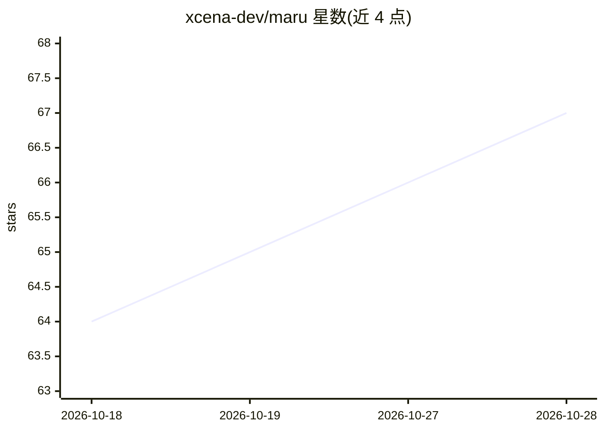

# xcena-dev/maru

⭐ 67 · Python · Apache-2.0 · 推送 2026-10-27 · [GitHub](https://github.com/xcena-dev/maru) · [官网](https://xcena-dev.github.io/maru/) · 组织维护

**面向 LLM 推理的 CXL/RDMA 共享内存 KV Cache 存储引擎**

Maru 是构建在 CXL 共享内存池与 RDMA 内存池之上的 KV cache 存储引擎，供多个 LLM 推理实例共享同一份 KV cache：CXL 节点直接读写共享内存实现零拷贝，无 CXL 的 GPU 节点通过 remote_cxl 后端以单边 RDMA 访问内存节点的 CXL 内存。系统由 Resource Manager（C++）、Metadata Server（Python）、嵌入推理实例的 MaruHandler 客户端库及可选 Remote CXL Agent 组成，可作为 LMCache 存储后端或通过 MaruKVConnector 直接接入 vLLM（需 v0.14+）。要求 Ubuntu 24.04+、Python 3.12+、CXL DAX 设备或仿真环境，源码安装经 install.sh 编译。附带 marutop 监控工具。

## 筛选速览

| 维度 | 判定 | 备注 |
|---|---|---|
| AI 角色 | `ai-ecosystem` | LLM/agent 周边工具 |
| 许可风险 | `permissive` | Apache-2.0 |
| 部署形态 | `library` | 以包/库形式分发 |
| 模型依赖 | local-ok | 支持本地模型 |
| 硬件要求 | — | 无带数字的原话,不猜 |
| 安装摩擦 | `medium` | 含编译或系统依赖之一 |
| 成熟度 | — | 结构信号不足 |

## 能力要点

- CXL 节点上零拷贝共享 KV cache，仅元数据（数十字节）跨组件传输
- remote_cxl 后端让无 CXL 的 GPU 节点经单边 RDMA 访问内存池
- 原生 LMCache 存储后端与 vLLM MaruKVConnector 两种接入方式
- marutop 命令行工具：DAX 池、实例用量与延迟吞吐监控

## 适用场景

- 多 vLLM 实例间共享 KV cache，避免重算前缀
- 长上下文、高并发推理场景下减少 KV 传输开销
- 混合部署中让无 CXL 的 GPU 节点使用远端 CXL 内存池

## 场景标签

 · 领域:LLM 推理基础设施/存储

## 证据(README 行号)

> L8: **Maru** is a high-performance **KV cache storage engine built on shared memory pools**, designed for LLM inference 
> L145: LMCache integration uses a CXL memory pool (`cxl` backend); GPU nodes without CXL use the vLLM connector with `mar
> L149: `MaruKVConnector` is a KV connector that plugs Maru into vLLM directly, without LMCache. vLLM loads it from the `m

## 星数曲线

2026-10-18 64 → 2026-10-28 67（+3）

---
*卡片 v1 · prompt 1.4 · 生成 2026-10-24 · 置信度 mid · 依据 README sha `be44ebd02e51` · [字段定义](../../DATASET.md)*
