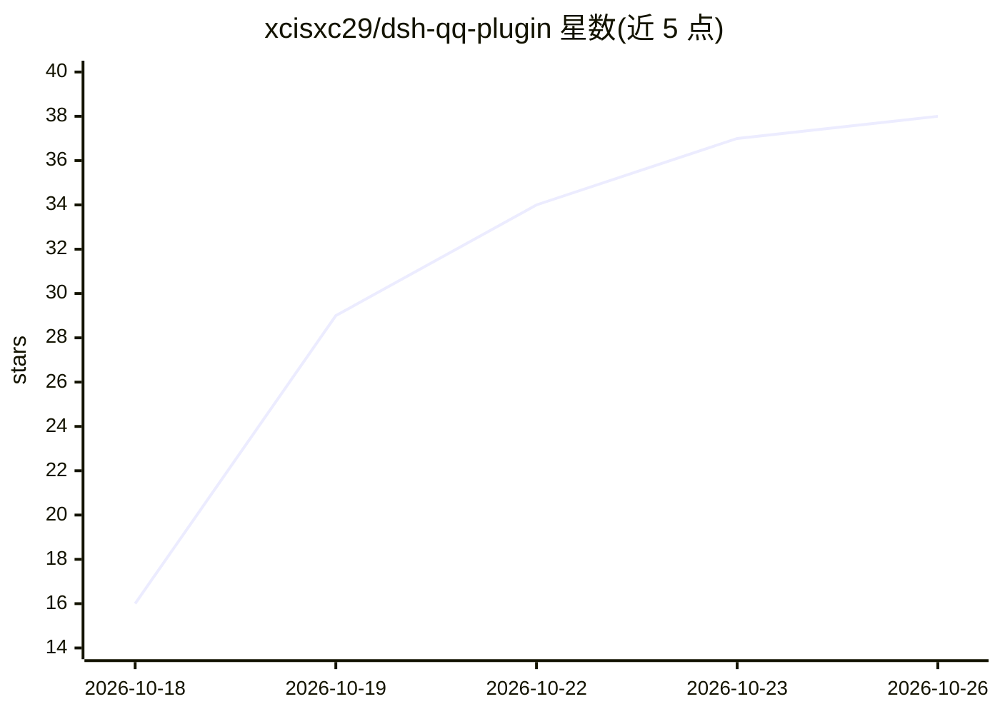

# xcisxc29/dsh-qq-plugin

⭐ 38 · JavaScript · MIT · 推送 2026-10-20 · [GitHub](https://github.com/xcisxc29/dsh-qq-plugin) · 个人维护 · 中文 README

**在 QQ 中远程驱动本机 DeepSeek Harness agent 的插件**

面向 DSH 桌面应用（@deepseek-ai/dsh-desktop 0.2.0-rc.2+）的插件，通过腾讯官方 QQ 机器人平台（api.bot.qq.com，扫码绑定）把 QQ 消息转发为本机 DSH agent 的提示词并将回复送回手机，无需公网 IP、反向代理或第三方协议客户端。支持文本/图片/文件/语音双向传输、多会话切换（/new、/list、/switch 等）、手机端选择模型与推理等级、远程应答权限确认、notify_qq 主动推送与定时任务通道。凭据存于 DSH 凭据存储，插件状态文件只记录 AppID。

## 筛选速览

| 维度 | 判定 | 备注 |
|---|---|---|
| AI 角色 | `ai-ecosystem` | LLM/agent 周边工具 |
| 许可风险 | `permissive` | MIT |
| 部署形态 | `None` |  |
| 模型依赖 | locked-api |  |
| 硬件要求 | — | 无带数字的原话,不猜 |
| 安装摩擦 | `low` | 无编译、无系统依赖或容器化 |
| 成熟度 | — | 结构信号不足 |

## 能力要点

- 经腾讯官方 QQ 机器人平台扫码绑定，无需公网 IP 或第三方协议客户端
- 文本/图片/文件/语音双向传输，超长回复自动转 .md 文件发送
- 手机端管理多个 DSH 会话、切换模型与推理等级、应答权限确认
- notify_qq 主动推送与 DSH 原生定时任务通道

## 适用场景

- 离开电脑后在手机 QQ 上继续指挥本机 agent 干活
- 让 agent 把电脑上的文件直接发到手机
- 任务完成或闹钟到点时收到 QQ 主动推送

## 场景标签

`聊天机器人` · 领域:对话与助手

## 证据(README 行号)

> L7: Drive the DeepSeek Harness agent on this computer from your phone, in QQ.
> L55: **For the DSH desktop app** on a machine that stays on. It needs DSH's workspace, tool and UI
> L60: |DSH desktop|`@deepseek-ai/dsh-desktop` `0.2.0-rc.2` or newer|

## 星数曲线

2026-10-18 16 → 2026-10-26 38（+22）

---
*卡片 v1 · prompt 1.4 · 生成 2026-10-25 · 置信度 high · 依据 README sha `90ca9e5a9baa` · [字段定义](../../DATASET.md)*
