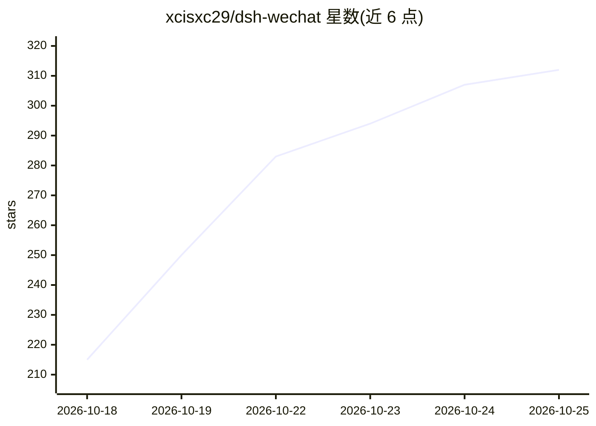

# xcisxc29/dsh-wechat

⭐ 312 · TypeScript · MIT · 推送 2026-10-20 · [GitHub](https://github.com/xcisxc29/dsh-wechat) · 个人维护 · 中文 README

**用微信远程操控电脑上 DeepSeek Harness agent 的插件**

面向 DeepSeek Harness（DSH）桌面应用的 WeChat 通道插件：微信消息转为 DSH 提示词，回复回传微信；支持文件、语音、视频双向传输，一个微信会话可切换多个 DSH 会话（/new、/list、/model、/switch 等命令与自然语言），权限确认可从手机答复，会话可主动向微信推送。通过腾讯官方 iLink 网关通信，扫码后加密绑定单一微信账号；默认全权限运行是需注意的限制。安装途径包括 npm 包、Git URL、tarball 与命令行，针对 DSH 0.2.0-rc.2 开发测试。

## 筛选速览

| 维度 | 判定 | 备注 |
|---|---|---|
| AI 角色 | `ai-ecosystem` | LLM/agent 周边工具 |
| 许可风险 | `permissive` | MIT |
| 部署形态 | `library` | 以包/库形式分发 |
| 模型依赖 | locked-api |  |
| 硬件要求 | — | 无带数字的原话,不猜 |
| 安装摩擦 | `low` | 无编译、无系统依赖或容器化 |
| 成熟度 | — | 结构信号不足 |

## 能力要点

- 微信消息与 DSH agent 提示词双向转换，附件与文件可互相传递
- 一个微信聊天管理多个 DSH 会话：命令与自然语言切换、列模型、改推理等级
- 权限确认与选择题从手机上以数字答复，会话可主动推送结果到微信
- 仅连接腾讯官方 iLink 网关，扫码后加密绑定单一微信账号

## 适用场景

- 人在离开电脑时用微信继续指挥家里的 DSH agent 干活
- 让长时间任务完成后主动推送结果到手机
- 用语音在微信里下达指令、接收 agent 生成的文件与图片

## 场景标签

 · 领域:AI agent 通道/远程操控

## 证据(README 行号)

> L7: Control DeepSeek Harness from WeChat: chat on your phone, and the DSH agent on your computer does the
> L12: **Runs on the current DSH desktop app** — developed and tested against DSH `0.2.0-rc.2`, and kept
> L49: **For the DSH desktop app.** It needs DSH's workspace, tool and UI services — the standard desktop

## 星数曲线

2026-10-18 215 → 2026-10-25 312（+97）

---
*卡片 v1 · prompt 1.4 · 生成 2026-10-22 · 置信度 high · 依据 README sha `2641da9bfd43` · [字段定义](../../DATASET.md)*
