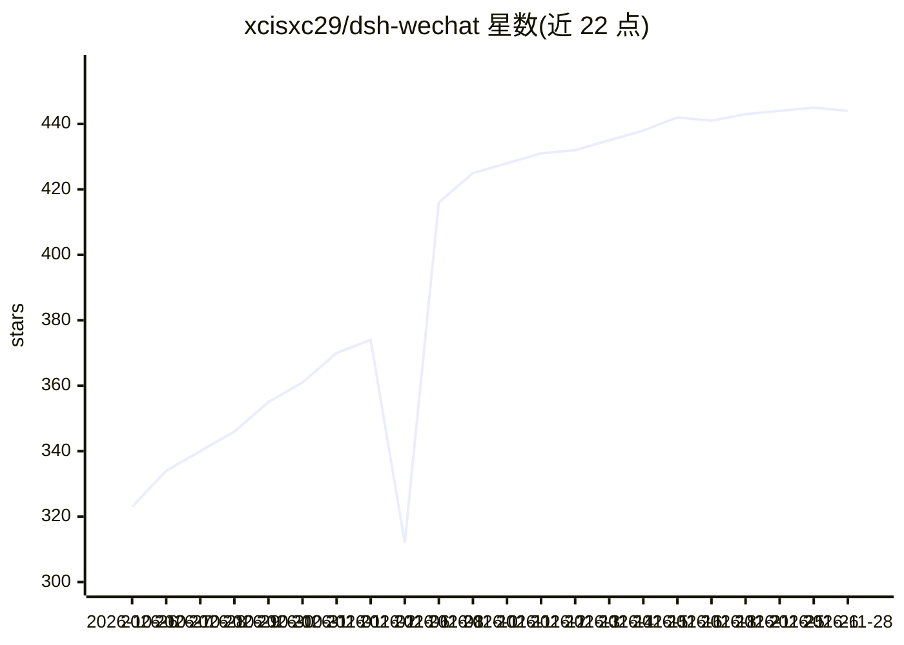

# xcisxc29/dsh-wechat

⭐ 444 · TypeScript · MIT · 推送 2026-10-26 · [GitHub](https://github.com/xcisxc29/dsh-wechat) · 个人维护 · 中文 README

**通过微信远程控制电脑上 DeepSeek Harness agent 的 DSH 插件**

DSH（DeepSeek Harness）桌面应用的 WeChat 通道插件：把微信消息转为 DSH prompt，回复与附件双向回传，支持文字、图片、文件、语音、视频。可在手机上用 /new、/switch、/model 等命令管理多个 DSH 会话，并以编号应答权限确认，使离开电脑不阻塞 agent 任务；任一会话可主动推送到微信。安装依赖 DSH 桌面应用（workspace、tool、UI 服务），需在常开机器上运行；语音转文字需可选安装 silk-wasm 编解码插件。安全上通过腾讯 iLink 网关与扫码账号密码学绑定，且微信会话默认以完全权限运行 agent。

## 筛选速览

| 维度 | 判定 | 备注 |
|---|---|---|
| AI 角色 | `ai-ecosystem` | LLM/agent 周边工具 |
| 许可风险 | `permissive` | MIT |
| 部署形态 | `library` | 以包/库形式分发 |
| 模型依赖 | locked-api |  |
| 硬件要求 | — | 无带数字的原话,不猜 |
| 安装摩擦 | `low` | 无编译、无系统依赖或容器化 |
| 成熟度 | — | 结构信号不足 |

## 能力要点

- 微信消息双向转为 DSH prompt 与回复，支持文字/图片/文件/语音/视频
- 单聊管理多个 DSH 会话：/new /list /switch /model /cancel，支持序号与短 id
- 手机端应答权限确认，任一会话可主动推送到微信
- 通过腾讯官方 iLink 网关绑定单一微信账号，无第三方中继

## 适用场景

- 外出时用手机指挥家里的电脑执行 agent 任务
- 在手机上应答 agent 的权限确认与选择题
- 让定时任务或后台会话完成后主动推送结果到微信

## 场景标签

`聊天机器人` `AI 助手` · 领域:对话与助手

## 证据(README 行号)

> L7: Control DeepSeek Harness from WeChat: chat on your phone, and the DSH agent on your computer does the
> L27: - **Text both ways.** Your WeChat message becomes a DSH prompt; the reply comes back to WeChat.
> L49: **For the DSH desktop app.** It needs DSH's workspace, tool and UI services — the standard desktop

## 星数曲线

2026-10-26 323 → 2026-11-28 444（+121）

---
*卡片 v1 · prompt 1.4 · 生成 2026-11-25 · 置信度 high · 依据 README sha `dd2d8c20efd5` · [字段定义](../../DATASET.md)*
