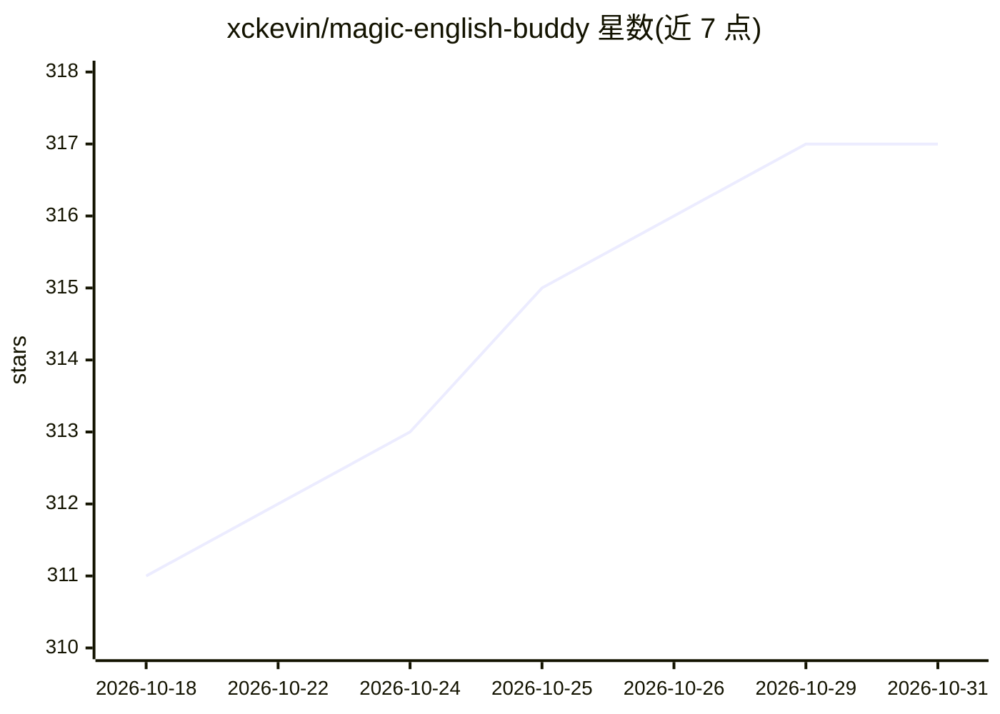

# xckevin/magic-english-buddy

⭐ 317 · TypeScript · NOASSERTION · 推送 2026-09-15 · [GitHub](https://github.com/xckevin/magic-english-buddy) · [官网](https://xckevin.github.io/magic-english-buddy/) · 个人维护 · 中文 README

**离线优先的儿童英语阅读学习 PWA，含课程、词典与音频**

面向儿童的英语阅读学习 PWA：提供 L1–L7 共 90 篇分级课程、学习地图解锁、阅读跟读（逐词高亮、录音回放）、1,074 词条离线词典、四种题型练习、间隔重复生词复习、Buddy 养成与证书导出。课程、词典与学习记录存于本机，支持多孩子独立档案与 JSON 全量备份。朗读使用开发期由 Kokoro 模型预生成的 1,721 个 MP3（约 25.3 MB，按需下载），应用本身不运行模型。技术栈为 React 19 + Vite + PWA。

## 筛选速览

| 维度 | 判定 | 备注 |
|---|---|---|
| AI 角色 | `ai-enhanced` | 去掉 AI 部分产品仍成立 |
| 许可风险 | `none` | NOASSERTION |
| 部署形态 | `library` | 以包/库形式分发 |
| 模型依赖 | — | README 未给出锁定关系 |
| 硬件要求 | — | 无带数字的原话,不猜 |
| 安装摩擦 | `medium` | 含编译或系统依赖之一 |
| 成熟度 | `idea` | |

## 能力要点

- L1–L7 共 90 篇分级课程，按通关进度解锁学习地图
- 1,074 词条离线词典与 1,721 个预生成 MP3 音频包（断点续传、SHA-256 校验）
- 多孩子独立学习档案，本机保存进度，JSON 备份与恢复
- 间隔重复生词复习（1/3/7 天）与学习证书 PNG 导出

## 适用场景

- 让孩子离线跟读英语课文、查词和做练习
- 一台设备多个孩子各保留独立学习进度
- 出门前下载音频包，无网络时继续学习

## 场景标签

 · 领域:教育/语言学习

## 证据(README 行号)

> L55: 朗读优先使用 Kokoro 预生成音频，播放器读取实际词时间点来驱动高亮；无法使用预生成音频时尝试系统语音。系统语音的可用性取决于浏览器与设备，可靠的离线朗读应提前下载音频包。详见 逐词高亮与音频对齐。
> L156: 生成器使用 Kokoro；模型和生成环境只在开发机运行，应用分发预生成音频。修改课文或词典后应重新检查内容覆盖并更新音频。词典数据来源与补充脚本见 课程词典来源。
> L165: |音频|Kokoro 预生成 MP3、Web Audio、系统语音与 MediaRecorder|

## 星数曲线

2026-10-18 311 → 2026-10-31 317（+6）

---
*卡片 v1 · prompt 1.4 · 生成 2026-10-21 · 置信度 high · 依据 README sha `5ec638108b55` · [字段定义](../../DATASET.md)*
