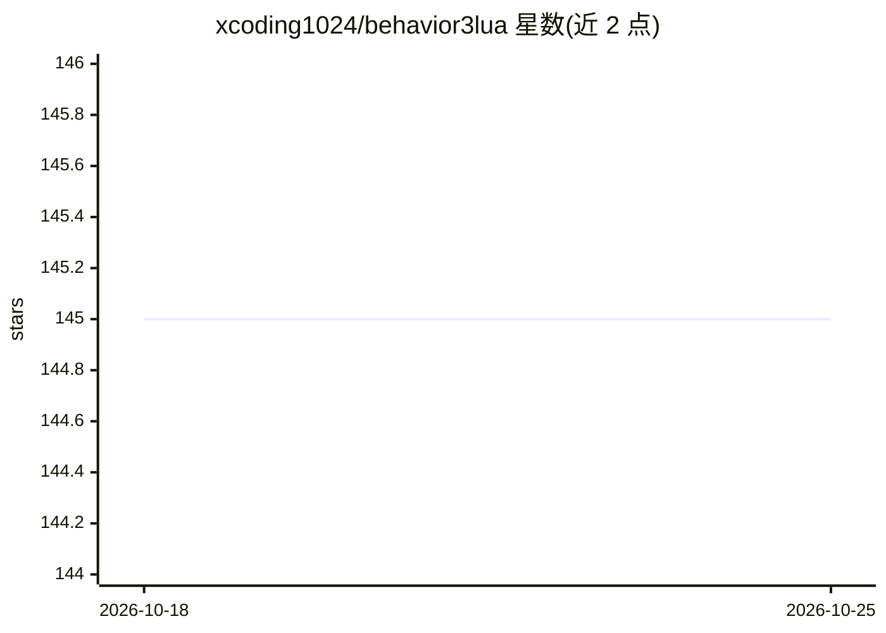

# xcoding1024/behavior3lua

⭐ 145 · Lua · MIT · 推送 2026-08-20 · [GitHub](https://github.com/xcoding1024/behavior3lua) · 个人维护 · 中文 README

**面向游戏策划的 Lua 行为树框架**

用 Lua 实现的行为树框架，将节点改造成函数式执行：节点通过 input 声明从黑板取参、执行结果写回变量，让策划通过编辑行为树组合逻辑。提供 Parallel/Sequence/Selector 复合节点、装饰节点、行为节点，支持 RUNNING 状态（调用栈压栈恢复）、节点级调试日志方案，作者称已在动作、卡牌、MOBA、MMO 项目中使用，另有基于 G6+Electron 的配套行为树编辑器 behavior3editor。

## 筛选速览

| 维度 | 判定 | 备注 |
|---|---|---|
| AI 角色 | `ai-ecosystem` | LLM/agent 周边工具 |
| 许可风险 | `permissive` | MIT |
| 部署形态 | `None` |  |
| 模型依赖 | — | README 未给出锁定关系 |
| 硬件要求 | — | 无带数字的原话,不猜 |
| 安装摩擦 | `low` | 无编译、无系统依赖或容器化 |
| 成熟度 | `idea` | |

## 能力要点

- 节点函数化：input 取参、结果写回黑板变量
- 支持 RUNNING 状态，通过调用栈压栈在下次 tick 恢复
- 提供 Parallel/Sequence/Selector 复合节点与装饰节点
- 配套 G6+Electron 行为树编辑器 behavior3editor

## 适用场景

- 游戏策划通过编辑行为树配置怪物/角色 AI 逻辑
- 动作、卡牌、MOBA、MMO 类项目的 AI 行为编排
- 需要直观逻辑表现的技能系统搭建

## 场景标签

`Agent 框架` · 领域:Agent 开发

## 证据(README 行号)

> L1: # 行为树框架 for Lua
> L2: 机缘巧合，近几年的工作一直有涉及到游戏AI这块，网上常见的行为树+黑板似乎不太能满足复杂策划需求，也不太可能让策划自己去配置这种行为树。因此，我对行为树的黑板进行了小改造，让行为树更像一个代码编辑器，我们程序提供为数不多的行为节点，

## 星数曲线

2026-10-18 145 → 2026-10-25 145（+0）

---
*卡片 v1 · prompt 1.4 · 生成 2026-10-23 · 置信度 high · 依据 README sha `18ebf04a2a39` · [字段定义](../../DATASET.md)*
