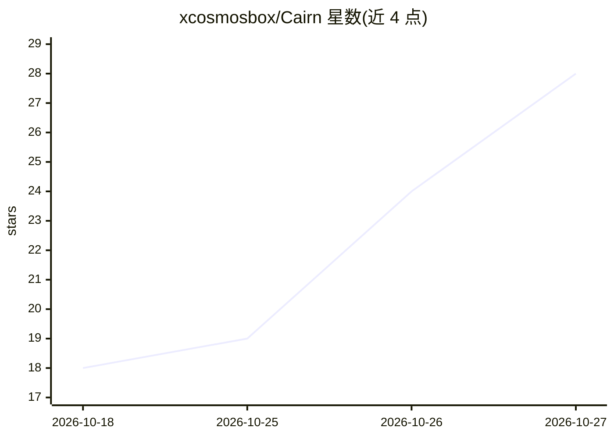

# xcosmosbox/Cairn

⭐ 28 · Go · MIT · 推送 2026-10-26 · [GitHub](https://github.com/xcosmosbox/Cairn) · 个人维护 · 中文 README

**面向 AI Agent 的领域知识图谱层：蒸馏 Skill 文档并以 MCP 交付**

开源三件套（构建端 cairnd 等 7 个二进制 + MCP 查询服务 + Viewer）：用 LLM 把 Skill 文档蒸馏为双层知识图谱（领域/子域结构层 + 实体/概念内容层），存于 SQLite+FTS5，Agent 通过 MCP（stdio/SSE/REST）按需检索子图。查询端只读、零 LLM、零 embedding（由 make verify 架构不变量强制）。支持增量更新（仅重算受影响子域）、结构化回写源仓库（人工编辑保留且 LLM 不再覆盖）、不可变 Bundle 经 GitHub Release 分发与热切换回滚。默认 DeepSeek API，需 OpenAI/Anthropic 兼容端点与 Go 1.22+ 源码构建。

## 筛选速览

| 维度 | 判定 | 备注 |
|---|---|---|
| AI 角色 | `ai-ecosystem` | LLM/agent 周边工具 |
| 许可风险 | `permissive` | MIT |
| 部署形态 | `library` | 以包/库形式分发 |
| 模型依赖 | locked-api |  |
| 硬件要求 | — | 无带数字的原话,不猜 |
| 安装摩擦 | `low` | 无编译、无系统依赖或容器化 |
| 成熟度 | — | 结构信号不足 |

## 能力要点

- 双层知识图谱 + 6 种枚举语义关系，Agent 按需检索子图
- 增量更新四类变更分类，未涉及对象零改动；人工编辑 provenance 升级为 human_curated
- 查询端零 LLM/零 embedding 的架构不变量由 make verify 强制检查
- LLM 提议、代码裁决：UUID 确定性派生，输出校验不合法则跳过

## 适用场景

- 团队把散落的 Skill 文档整理成可查询知识库供 AI Agent 检索
- 文档频繁变更时自动增量维护知识图谱并保留人工编辑
- 通过 MCP 让多个 Agent 共享同一领域知识源，Bundle 热更新零中断

## 场景标签

`知识图谱` · 领域:知识与检索

## 证据(README 行号)

> L6: > Continuously turn knowledge scattered across skill documents into a queryable,
> L161: |`cairn-mcp`|service|MCP Server：stdio / SSE / REST 三种传输，支持 catalog 自动热更新|

## 星数曲线

2026-10-18 18 → 2026-10-27 28（+10）

---
*卡片 v1 · prompt 1.4 · 生成 2026-10-27 · 置信度 mid · 依据 README sha `91533c2e7bbe` · [字段定义](../../DATASET.md)*
