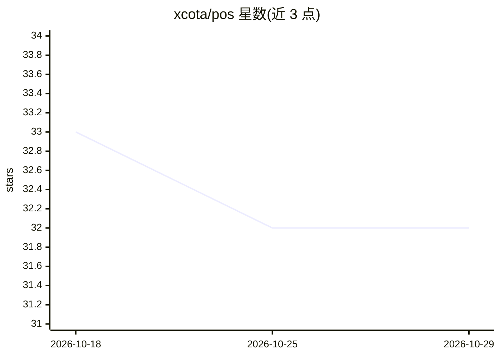

# xcota/pos

⭐ 32 · Python · AGPL-3.0 · 推送 2026-10-18 · [GitHub](https://github.com/xcota/pos) · 个人维护 · 中文 README

**给 Claude Code 加持久记忆的本地 Markdown 文件夹（面向普通用户）**

一个下载到本机的文件夹（Camomile），配合 Claude Code 与付费 Claude 计划使用：助手把用户是谁、在做什么、做过什么决定写入用户磁盘上的纯文本文件，并在每次对话开始时重读。提供语义搜索（可选安装，约 1GB 辅助文件）、七个人生领域卡片、/session-save、/recall、/reflect 三个命令，以及每隔数日经确认后自动整理记忆与复盘。数据全部存本地，无账号无服务器；对话内容会发送至 Anthropic 服务器。仅支持 Mac/Linux，Windows 不可用，无需写代码。

## 筛选速览

| 维度 | 判定 | 备注 |
|---|---|---|
| AI 角色 | `ai-native` | 本体是模型或模型工具 |
| 许可风险 | `viral` | AGPL-3.0 |
| 部署形态 | `None` |  |
| 模型依赖 | locked-api |  |
| 硬件要求 | — | 无带数字的原话,不猜 |
| 安装摩擦 | `low` | 无编译、无系统依赖或容器化 |
| 成熟度 | — | 结构信号不足 |

## 能力要点

- 记忆以用户磁盘上的普通 Markdown 文件存储，可随时复制或删除
- 可选的按语义搜索：能以不同措辞找回旧记录（约 1GB 磁盘占用）
- 三个斜杠命令：/session-save、/recall、/reflect，其余由助手主动提出并经用户确认
- 明确不采集密码/密钥/卡号，写入其规则

## 适用场景

- 我不想每次和 AI 对话都重新自我介绍
- 把暂停一个月的项目接回来，问一句'我上次停在哪'
- 让 AI 记住我的沟通偏好，比如少写、别连问两个问题
- 用本地文件而非云端服务管理个人记录

## 场景标签

`Agent 记忆` · 领域:Agent 开发

## 证据(README 行号)

> L13: **A folder on your computer where an AI assistant remembers you: what you are doing, what you decided, and how you 
> L31: - **The Claude Code program and a paid Claude plan** (Pro or Max, from Anthropic). Claude Code is a program made by

## 星数曲线

2026-10-18 33 → 2026-10-29 32（-1）

---
*卡片 v1 · prompt 1.4 · 生成 2026-10-25 · 置信度 high · 依据 README sha `badfc4f08512` · [字段定义](../../DATASET.md)*
