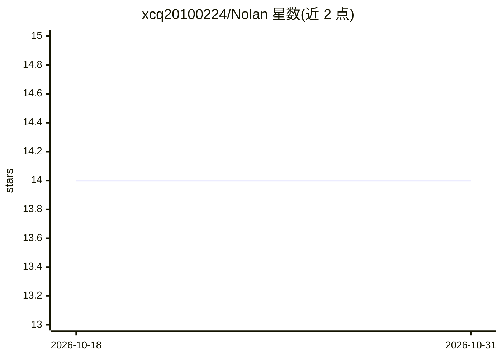

# xcq20100224/Nolan

⭐ 14 · Python · MIT · 推送 2026-08-17 · [GitHub](https://github.com/xcq20100224/Nolan) · [官网](https://github.com/xcq20100224/Nolan#readme) · 个人维护 · 中文 README

**Windows 中文语音 AI 管家：语音操作电脑与主动提醒**

本地优先的 Windows 中文语音助手：faster-whisper 在 CPU 上做本地中文识别，GLM-5.2 agent 循环驱动 14 个工具（含沙盒化 shell 命令、文件读写、媒体控制），GLM-4.5V 做屏幕理解并配合 pyautogui 自动化 GUI，GLM-TTS 语音播报并支持全双工打断。另提供长期记忆、闹钟与条件触发（如明天下雨提醒带伞）、大目标分层规划与技能固化。需自备智谱 API Key，云端模型调用依赖智谱开放平台；提供网页版、tkinter 桌面版与命令行三种运行形态，一键安装脚本要求 Python 3.10+ 与 Node.js LTS。

## 筛选速览

| 维度 | 判定 | 备注 |
|---|---|---|
| AI 角色 | `ai-native` | 本体是模型或模型工具 |
| 许可风险 | `permissive` | MIT |
| 部署形态 | `library` | 以包/库形式分发 |
| 模型依赖 | — | README 未给出锁定关系 |
| 硬件要求 | — | 无带数字的原话,不猜 |
| 安装摩擦 | `low` | 无编译、无系统依赖或容器化 |
| 成熟度 | — | 结构信号不足 |

## 能力要点

- faster-whisper 本地中文识别（README 实测 CPU 1.53× 实时）
- GLM-5.2 agent 循环驱动 14 个工具，含沙盒化任意 shell 命令
- 截屏 + GLM-4.5V 视觉理解 + pyautogui 的 GUI 自动化
- 全双工打断播报（能量门 + 回声文本过滤，无需 AEC）

## 适用场景

- 对着麦克风说中文让 AI 替我操作 Windows 应用
- 设置条件提醒，如明天下雨提醒带伞、定时提醒喝水
- 让 AI 记住偏好并跨会话回忆，做长期个人管家

## 场景标签

`语音 Agent` `GUI 自动化` · 领域:效率与自动化

## 证据(README 行号)

> L5: > Nolan is a local-first, Chinese-speaking voice butler for Windows. It listens with faster-whisper (1.5× real-time 
> L57: Nolan 是一个**本地优先的 Windows 中文语音 AI 管家**：对着麦克风说中文，它不仅能听懂、会回答，还能真的动手——执行 shell 命令、操作应用程序、控制媒体播放、看屏幕、记事情、定闹钟、**按条件主动行动**
> L61: - 🎙️ **语音对话**：faster-whisper 本地中文识别（CPU 上 1.53× 实时）+ 自然语音播报，全程免键盘

## 星数曲线

2026-10-18 14 → 2026-10-31 14（+0）

---
*卡片 v1 · prompt 1.4 · 生成 2026-10-31 · 置信度 high · 依据 README sha `b7f7540ea452` · [字段定义](../../DATASET.md)*
