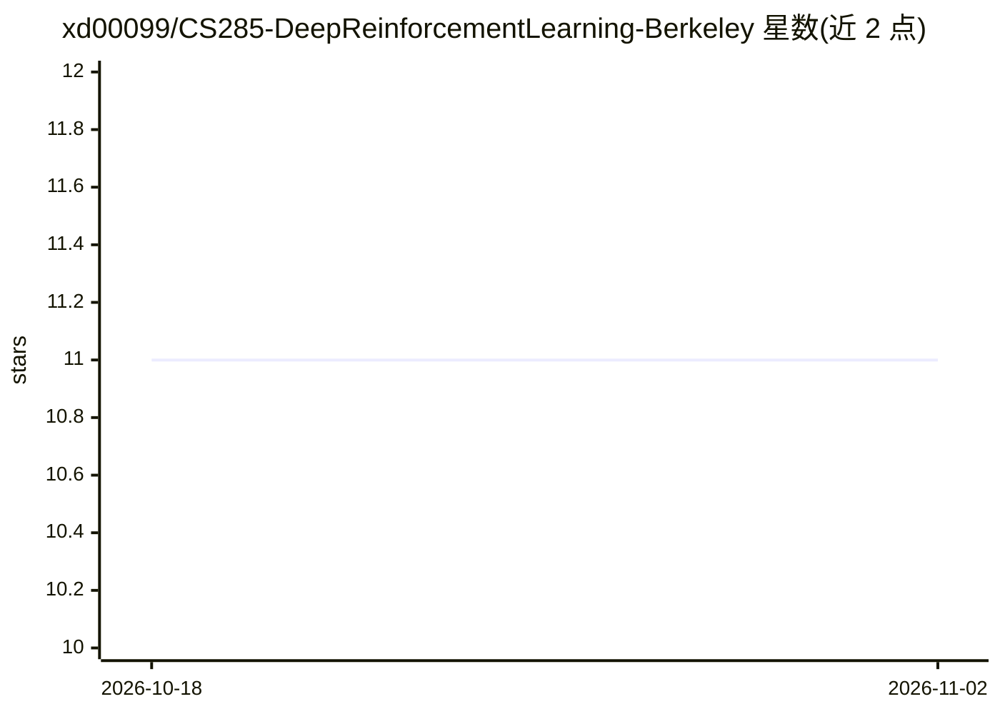

# xd00099/CS285-DeepReinforcementLearning-Berkeley

⭐ 11 · Jupyter Notebook · 推送 2026-09-23 · [GitHub](https://github.com/xd00099/CS285-DeepReinforcementLearning-Berkeley) · 个人维护

**伯克利 CS285 深度强化学习课程作业的个人解答集**

UC Berkeley CS285（深度强化学习、决策与控制）Fall 2022 课程作业的个人解答仓库，作者声明已通过全部 Gradescope 测试但可能仍有错误，供学习受阻时参考而非直接复制。内容覆盖模仿学习（BC、DAgger）、策略梯度等课程主题的算法实现，按 hw 编号组织目录，内含 cs285 运行脚本。依赖 Python 3.7 与 mujoco 2.2.0 等环境，需自行配置后运行。

## 筛选速览

| 维度 | 判定 | 备注 |
|---|---|---|
| AI 角色 | `ai-knowledge` | 知识聚合/清单类 |
| 许可风险 | `none` | — |
| 部署形态 | `None` |  |
| 模型依赖 | — | README 未给出锁定关系 |
| 硬件要求 | — | 无带数字的原话,不猜 |
| 安装摩擦 | `low` | 无编译、无系统依赖或容器化 |
| 成熟度 | — | 结构信号不足 |

## 能力要点

- 覆盖 CS285 各次作业（模仿学习、DAgger 等课程主题）的实现代码
- 作者声明已通过全部 Gradescope 测试
- 按 hw[number]/cs285 目录组织，含运行脚本

## 适用场景

- 学习 CS285 课程时对照参考作业实现
- 理解 BC、DAgger 等算法的代码实现方式

## 场景标签

`教程课程` · 领域:学习与行业

## 证据(README 行号)

> L1: # UC Berkeley CS285 Deep Reinforcement Learning Fall 2022
> L2: My Solutions of Assignments for Berkeley CS 285: Deep Reinforcement Learning, Decision Making, and Control.
> L24: - HW 1: Imitation Learning

## 星数曲线

2026-10-18 11 → 2026-11-02 11（+0）

---
*卡片 v1 · prompt 1.4 · 生成 2026-11-01 · 置信度 high · 依据 README sha `e292131bc319` · [字段定义](../../DATASET.md)*
