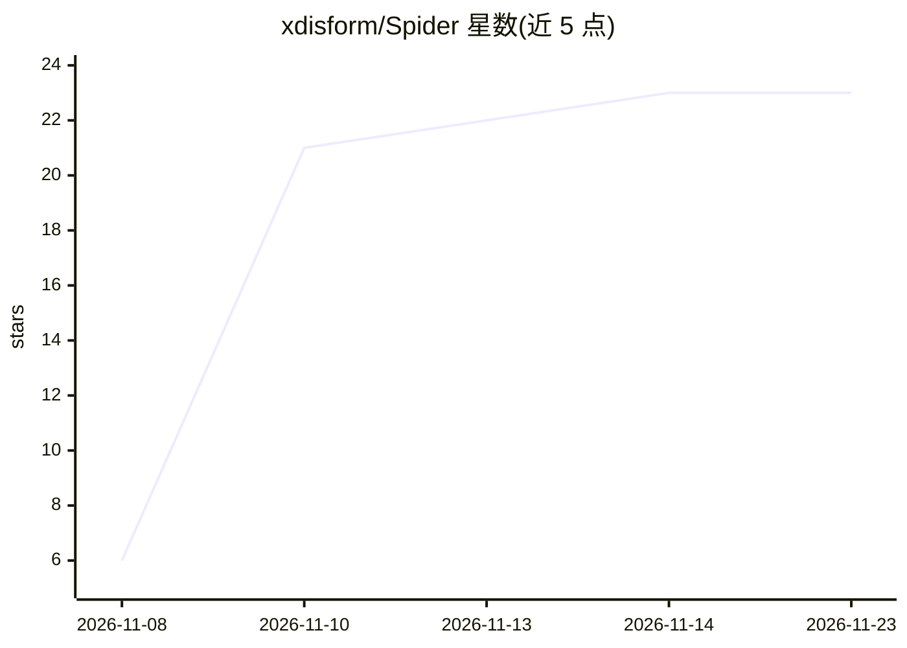

# xdisform/Spider

⭐ 23 · Python · NOASSERTION · 推送 2026-11-08 · [GitHub](https://github.com/xdisform/Spider) · [官网](https://disform.ru) · 个人维护

**把 Claude Code 变成自治渗透测试红队领队的多智能体系统**

以提示与技能层形式运行于 Claude Code 之上的多智能体渗透测试系统：最多约 30 个清洁上下文 agent 组成集群，按 scope→recon→deep recon→attack→chain→triage→report 循环执行侦察、漏洞利用与 OSINT，由技术领队智能体分配任务并综合结果。发现需经确定性 oracle 复现与三阶段对抗性 triage 才输出报告；含 scope/rate/egress 失败封闭代理限制目标范围。附 nuclei、sqlmap 等 bin/ 工具栈，需 git clone 安装并配合 scope.yaml 与人工 GO 门控使用，仅限授权测试。

## 筛选速览

| 维度 | 判定 | 备注 |
|---|---|---|
| AI 角色 | `ai-native` | 本体是模型或模型工具 |
| 许可风险 | `permissive` | NOASSERTION |
| 部署形态 | `None` |  |
| 模型依赖 | — | README 未给出锁定关系 |
| 硬件要求 | — | 无带数字的原话,不猜 |
| 安装摩擦 | `low` | 无编译、无系统依赖或容器化 |
| 成熟度 | — | 结构信号不足 |

## 能力要点

- 最多约 30 个 agent 的集群执行侦察、利用与 OSINT，含失败反思重试机制
- 确定性 oracle + CVSS 3.1 + 三阶段对抗性 triage 的发现验证机制
- scope/rate/egress 失败封闭代理与 pre-commit 防泄漏守卫
- 92 个方法论技能包与 10 种 agent 角色定义

## 适用场景

- 授权范围内自动化执行漏洞赏金项目的侦察与利用全流程
- 把已证发现组合成 kill-chain 并生成可提交的报告
- 安全团队对目标资产做多角度攻击面假设验证

## 场景标签

`多智能体` `网络安全` · 领域:Agent 开发

## 证据(README 行号)

> L19: Spider turns **Claude Code** into an autonomous red-team lead. No scanner, no Docker, no glue code — **the whole en
> L43: - **A fleet, not a bot.** Up to **~30 clean-context agents per task**, each armed with the real arsenal (`bin/` — n
> L44: - **Autonomous, in cycles.** scope → recon → deep recon → attack → chain → triage → report — each phase a fleet plu

## 星数曲线

2026-11-08 6 → 2026-11-23 23（+17）

---
*卡片 v1 · prompt 1.4 · 生成 2026-11-18 · 置信度 high · 依据 README sha `8c5f7f96c402` · [字段定义](../../DATASET.md)*
