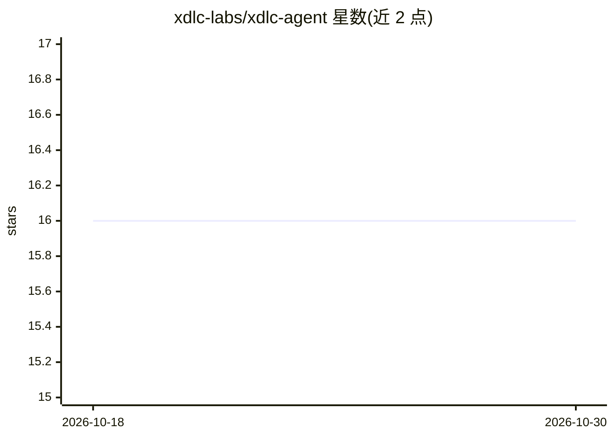

# xdlc-labs/xdlc-agent

⭐ 16 · Go · MIT · 推送 2026-09-16 · [GitHub](https://github.com/xdlc-labs/xdlc-agent) · [官网](https://xdlc.dev/agent/docs) · 组织维护

**自托管 CI 修复编排器：CI 失败时驱动编码 agent 自动开修复 PR**

自托管的 Go 工具：监控 GitHub Actions 失败运行，经策略门（Fix/Promote/Revert/noop）判定后将失败日志与仓库约定交给用户自选的编码 agent CLI（claude/codex/cursor-agent/gemini），在独立 git worktree 中提交，由 xdlc 推送并开 PR；每个 Fix 记录 prompt、diff、判定与成本。支持单命令 xdlc fix、守护进程模式、Web 控制台、Docker 与 Helm 部署；可选用 DEV 冒烟后 promote 与生产故障 revert。面向拥有编码 agent 订阅、希望无人值守修复 CI 的平台/运维开发者。

## 筛选速览

| 维度 | 判定 | 备注 |
|---|---|---|
| AI 角色 | `ai-ecosystem` | LLM/agent 周边工具 |
| 许可风险 | `permissive` | MIT |
| 部署形态 | `self-host` | docker 或自建部署 |
| 模型依赖 | — | README 未给出锁定关系 |
| 硬件要求 | — | 无带数字的原话,不猜 |
| 安装摩擦 | `low` | 无编译、无系统依赖或容器化 |
| 成熟度 | — | 结构信号不足 |

## 能力要点

- 策略门决定 Fix/Promote/Revert，agent 不自行决定是否运行
- 每个 Fix 使用独立 git worktree，不污染工作树
- 四种 agent CLI 提供方，支持按成本优先路由与预算上限
- 记录每个 Fix 的 prompt、输出、diff、判定与成本

## 适用场景

- CI 半夜失败时自动让编码 agent 修复并开 PR
- 多仓库统一策略管理自动修复、promote 与 revert
- 审计自动修复的完整记录（prompt/diff/成本）

## 场景标签

`编码 Agent` · 领域:编码与开发

## 证据(README 行号)

> L17: xdlc is that part, self-hosted. A failed GitHub Actions run becomes a **Fix**: your agent
> L21:  Signals from CI, DEV smoke and prod health enter a policy gate that decides Fix, Promote, Revert or noop. Only Fix
> L28: - **Your agent, your keys.** `claude`, `codex`, `cursor-agent` or `gemini` on `PATH`. Nothing phones home; there is

## 星数曲线

2026-10-18 16 → 2026-10-30 16（+0）

---
*卡片 v1 · prompt 1.4 · 生成 2026-10-30 · 置信度 mid · 依据 README sha `b74fb5a8a594` · [字段定义](../../DATASET.md)*
