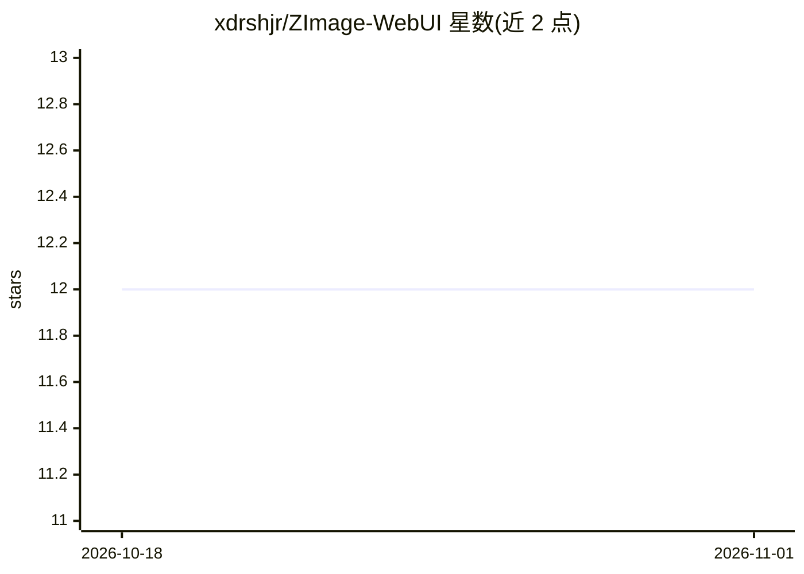

# xdrshjr/ZImage-WebUI

⭐ 12 · Python · 推送 2025-12-22 · [GitHub](https://github.com/xdrshjr/ZImage-WebUI) · 个人维护

**基于 Z-Image-Turbo 的文生图系统，前后端分离并含 AI 幻灯片生成**

由 Flask 后端与 Next.js 14 前端组成的完整 AI 图像生成系统：后端封装 Z-Image-Turbo 扩散模型，提供任务提交、队列管理、状态查询与结果获取 API；前端提供提示词输入、参数设置（尺寸/步数/种子）、批量生成（1-4 张）、提示词模板增强与预览下载。另含基于 LangGraph 与 OpenAI 兼容 LLM API 的智能幻灯片生成模块（可选）。运行需 CUDA 11.8+ 与至少 24GB GPU 显存，提供 start.sh 一键启动脚本，仅支持桌面浏览器。

## 筛选速览

| 维度 | 判定 | 备注 |
|---|---|---|
| AI 角色 | `ai-native` | 本体是模型或模型工具 |
| 许可风险 | `none` | — |
| 部署形态 | `library` | 以包/库形式分发 |
| 模型依赖 | — | README 未给出锁定关系 |
| 硬件要求 | — | 无带数字的原话,不猜 |
| 安装摩擦 | `medium` | 含编译或系统依赖之一 |
| 成熟度 | — | 结构信号不足 |

## 能力要点

- Z-Image-Turbo 模型文生图，支持自定义尺寸、1-50 推理步数与种子控制
- 任务队列管理与实时状态跟踪，适合生产环境部署
- LangGraph 多阶段工作流的 AI 幻灯片生成（HTML/PNG/PDF 输出）
- start.sh 一键构建前端并启动前后端服务

## 适用场景

- 在自有 GPU 服务器上部署文生图服务并通过 Web 界面使用
- 批量生成带参数控制的 AI 图像
- 用 LLM 加图像生成自动产出多页演示文稿

## 场景标签

`图像生成` · 领域:内容生成

## 证据(README 行号)

> L20: - **Backend Service**: Flask-based Z-Image-Turbo model API service providing image generation endpoints
> L31: - ✅ **AI Image Generation**: Powered by Z-Image-Turbo model for high-quality text-to-image generation

## 星数曲线

2026-10-18 12 → 2026-11-01 12（+0）

---
*卡片 v1 · prompt 1.4 · 生成 2026-10-31 · 置信度 high · 依据 README sha `f43a77bca274` · [字段定义](../../DATASET.md)*
