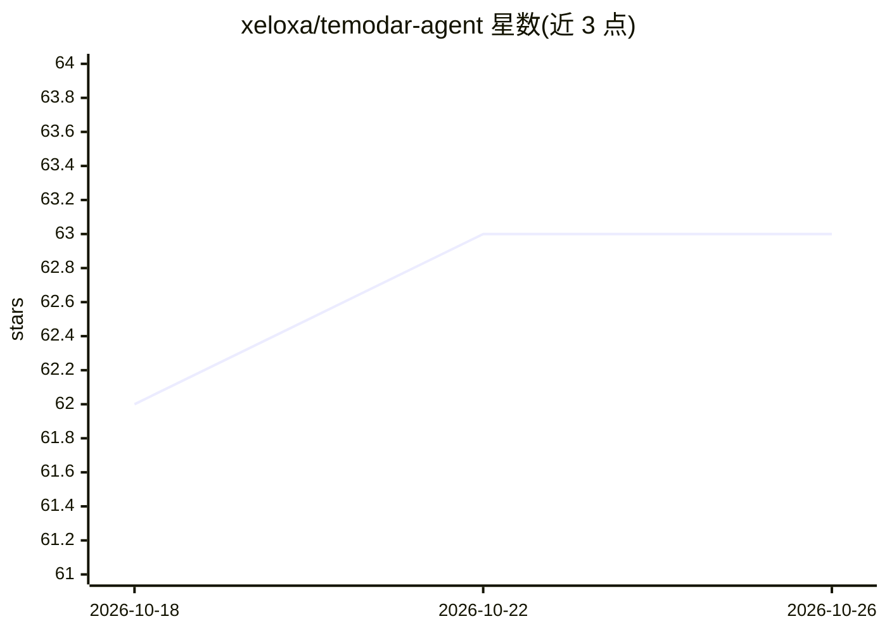

# xeloxa/temodar-agent

⭐ 63 · Python · Apache-2.0 · 推送 2026-07-03 · [GitHub](https://github.com/xeloxa/temodar-agent) · [官网](https://hub.docker.com/r/xeloxa/temodar-agent) · 个人维护

**AI agent 驱动的 WordPress 插件/主题安全分析平台**

面向安全研究人员、产品安全团队与审计人员的本地优先 Docker 应用：扫描 WordPress 插件与主题，按安装量、更新窗口等元数据做风险优先级排序，运行 Semgrep 静态分析（含 OWASP Top 10、PHP security 等内置规则集与自定义规则管理），并提供按目标保留上下文的源感知 AI 调查线程。支持多种 AI 执行策略（agent/team/tasks/fanout/auto）与 Anthropic、OpenAI、Copilot、Gemini、Grok 等多提供商配置。仅限授权安全研究用途。

## 筛选速览

| 维度 | 判定 | 备注 |
|---|---|---|
| AI 角色 | `ai-native` | 本体是模型或模型工具 |
| 许可风险 | `permissive` | Apache-2.0 |
| 部署形态 | `self-host` | docker 或自建部署 |
| 模型依赖 | locked-api |  |
| 硬件要求 | — | 无带数字的原话,不猜 |
| 安装摩擦 | `low` | 无编译、无系统依赖或容器化 |
| 成熟度 | — | 结构信号不足 |

## 能力要点

- WordPress 插件/主题扫描与基于元数据的风险优先级排序
- Semgrep 静态分析（内置 OWASP Top 10/PHP security/security audit 规则集，支持自定义规则）
- 按目标保留上下文的源感知 AI 调查线程与线程记忆
- 多提供商 LLM 配置（Anthropic/OpenAI/Copilot/Gemini/Grok）与多种 agent 执行策略

## 适用场景

- 安全团队从大量 WordPress 插件生态中筛选值得优先审查的目标
- 对插件源码跑 Semgrep 静态分析并用 AI 线程做深入调查
- 维护自定义 Semgrep 检测规则并批量扫描会话

## 场景标签

`网络安全` · 领域:学习与行业

## 证据(README 行号)

> L20:  AI agent-powered WordPress security scanner for plugin and theme triage, Semgrep analysis, and source-aware invest
> L22: Temodar Agent is an AI-powered WordPress plugin and theme security analysis platform built for security researchers

## 星数曲线

2026-10-18 62 → 2026-10-26 63（+1）

---
*卡片 v1 · prompt 1.4 · 生成 2026-10-24 · 置信度 high · 依据 README sha `62f4b698dcb3` · [字段定义](../../DATASET.md)*
