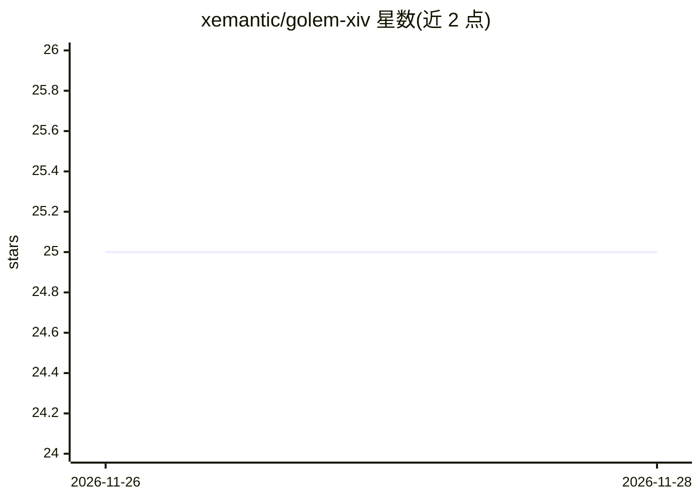

# xemantic/golem-xiv

⭐ 25 · Kotlin · AGPL-3.0 · 推送 2026-08-15 · [GitHub](https://github.com/xemantic/golem-xiv) · [官网](https://xemantic.com/golem-xiv/) · 个人维护

**自主执行知识工作的元认知 AI 系统，基于知识图谱记忆**

Golem XIV 是一个自主运行知识工作的元认知 AI 系统，通过持久化知识图谱记忆进行推理，产出代码、文档、设计与数据。其记忆以 Neo4j 图数据库承载、为组织私有；支持多认知并行、以自有编程语言进行自我修改与链式代码思考，并提出并验证假设（auto-science）。认知层不绑定特定 LLM，可接入多种推理模型。由 Kotlin 编写，经 Gradle 启动 Neo4j、Golem 服务与 Web 客户端三个进程，支持可选的 HTTP Basic 认证。

## 筛选速览

| 维度 | 判定 | 备注 |
|---|---|---|
| AI 角色 | `ai-native` | 本体是模型或模型工具 |
| 许可风险 | `viral` | AGPL-3.0 |
| 部署形态 | `None` |  |
| 模型依赖 | locked-api |  |
| 硬件要求 | — | 无带数字的原话,不猜 |
| 安装摩擦 | `low` | 无编译、无系统依赖或容器化 |
| 成熟度 | — | 结构信号不足 |

## 能力要点

- 以 Neo4j 知识图谱作为持久化、组织私有的记忆
- 自述 LLM 无关：可运行于多种推理模型
- 多认知并行与基于自有语言的自我修改
- 通过 Gradle 启动 Neo4j、服务端与 Web 客户端三个组件

## 适用场景

- 让系统自主产出代码与文档等知识工作产物
- 为组织维护私有上下文的知识图谱记忆
- 尝试自动提出并验证研究假设

## 场景标签

`知识图谱` · 领域:知识与检索

## 证据(README 行号)

> L3: In a nutshell, Golem XIV is a metacognitive AI system that autonomously performs knowledge work — producing code, do
> L9: * **Unlimited memory**: represented as Knowledge Graph
> L16: * **LLM-independence**: The cognition can be performed by any reasoning LLM: OpenAI (GPT), Anthropic (Claude), Goog

## 星数曲线

2026-11-26 25 → 2026-11-28 25（+0）

---
*卡片 v1 · prompt 1.4 · 生成 2026-11-27 · 置信度 mid · 依据 README sha `cbfbb3e886f8` · [字段定义](../../DATASET.md)*
