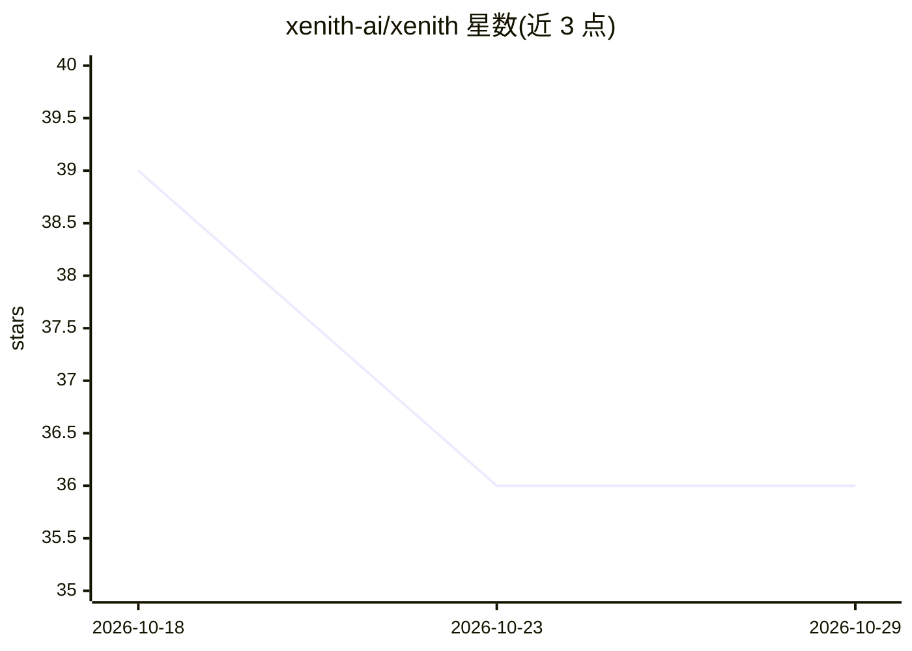

# xenith-ai/xenith

⭐ 36 · JavaScript · 推送 2026-03-03 · [GitHub](https://github.com/xenith-ai/xenith) · [官网](https://xenith.ai) · 组织维护

**浏览器内本地运行的 LLM 语音助手，数据不出设备**

基于 WebAssembly 的全客户端 LLM 语音助手：在浏览器内运行大语言模型推理，提供自定义唤醒词检测、可选合成语音与灵活的模型支持；语音识别使用 Whisper 的 C++/WebAssembly 移植，语音活动检测用 Silero VAD，语音合成经 vits-web，LLM 推理依赖 WebLLM 引擎。所有推理在本地浏览器完成，可离线使用；要求配备专用 GPU 与支持 WebGPU 的浏览器，否则运行极慢。

## 筛选速览

| 维度 | 判定 | 备注 |
|---|---|---|
| AI 角色 | `ai-native` | 本体是模型或模型工具 |
| 许可风险 | `none` | — |
| 部署形态 | `None` |  |
| 模型依赖 | — | README 未给出锁定关系 |
| 硬件要求 | — | 无带数字的原话,不猜 |
| 安装摩擦 | `low` | 无编译、无系统依赖或容器化 |
| 成熟度 | — | 结构信号不足 |

## 能力要点

- WebAssembly 驱动的全浏览器内 LLM 语音助手推理
- 自定义唤醒词检测与可选合成语音
- 组合 Whisper（whisper.cpp 移植）、Silero VAD、vits-web、WebLLM 等组件
- 数据不出设备，支持离线运行

## 适用场景

- 在浏览器中本地运行语音助手，避免数据上传
- 需要离线可用的 LLM 语音交互
- 在自有设备 GPU 上体验私有化 AI 助手

## 场景标签

`语音 Agent` `AI 助手` · 领域:对话与助手

## 证据(README 行号)

> L7: Powered by Web Assembly, Xenith enables fully client-side execution of LLM-based voice assistants with custom wake-w
> L15: - **Dedicated GPU** - This runs AI models directly on your machine via WebAssembly, meaning you'll need a GPU or it

## 星数曲线

2026-10-18 39 → 2026-10-29 36（-3）

---
*卡片 v1 · prompt 1.4 · 生成 2026-10-25 · 置信度 high · 依据 README sha `dbe33746622f` · [字段定义](../../DATASET.md)*
