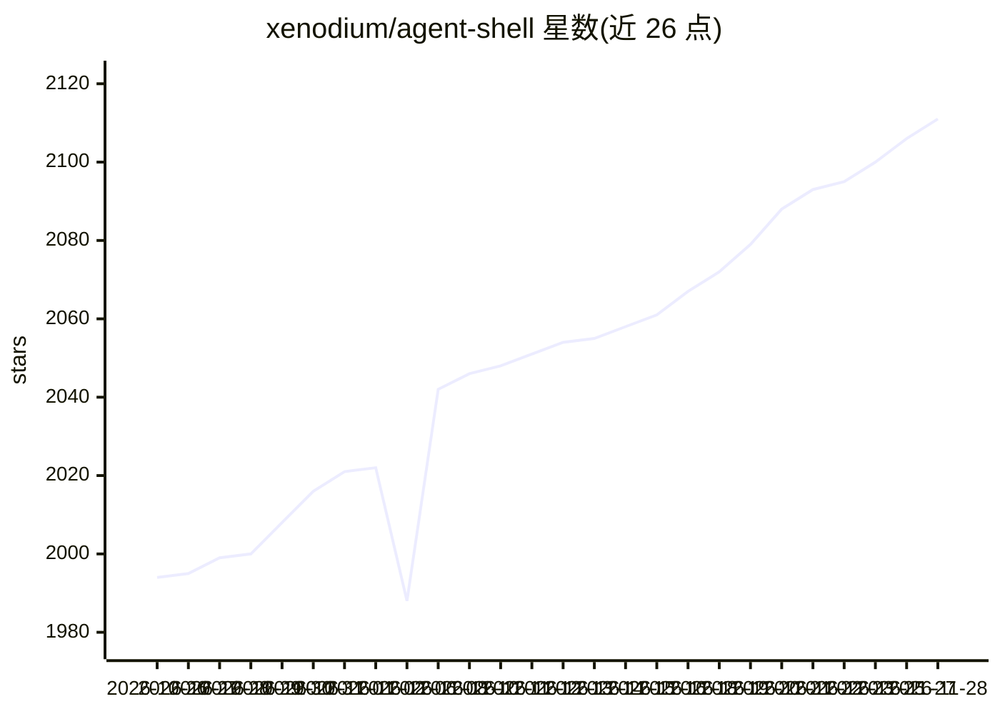

# xenodium/agent-shell

⭐ 2,111 · Emacs Lisp · GPL-3.0 · 推送 2026-11-27 · [GitHub](https://github.com/xenodium/agent-shell) · [官网](https://xenodium.com) · 个人维护

**在 Emacs 缓冲区中运行 AI 编码 agent 的 ACP 客户端**

面向 Emacs 用户的 AI agent 客户端：通过 Agent Client Protocol (ACP) 接入 24 个 agent（Claude Agent、Codex、Gemini CLI、Goose、Cursor CLI 等），让用户在熟悉的 Emacs 缓冲区与键位中使用 agent，不经过终端仿真。依赖 acp.el 与各 agent 的 ACP 桥接/CLI 安装到 PATH。围绕该项目已形成 20 余个第三方扩展包（通知、会话管理、Docker 沙箱、多 agent 协同等）。通过 MELPA 分发。

## 筛选速览

| 维度 | 判定 | 备注 |
|---|---|---|
| AI 角色 | `ai-ecosystem` | LLM/agent 周边工具 |
| 许可风险 | `viral` | GPL-3.0 |
| 部署形态 | `self-host` | docker 或自建部署 |
| 模型依赖 | local-ok | 支持本地模型 |
| 硬件要求 | — | 无带数字的原话,不猜 |
| 安装摩擦 | `low` | 无编译、无系统依赖或容器化 |
| 成熟度 | — | 结构信号不足 |

## 能力要点

- 通过 ACP 接入 24 个 AI agent，且任何支持 ACP 的 agent 均可使用
- 以 Emacs 缓冲区与键位运行 agent，无终端仿真
- 依赖 acp.el 与 Agent Client Protocol 通信
- 20 余个第三方扩展包生态（通知/会话管理/沙箱等）

## 适用场景

- 在 Emacs 内与 Claude Agent、Codex、Gemini CLI 等 agent 对话完成编码任务
- 统一界面管理多个 ACP agent 会话
- 保持既有 Emacs 工作流接入 AI agent

## 场景标签

`编码 Agent` `AI 助手` · 领域:编码与开发

## 证据(README 行号)

> L20: =agent-shell= brings your favorite AI agents to [[https://www.gnu.org/software/emacs/][Emacs]], keeping you at home
> L22: Works with 24 agents today, and any other that speaks ACP:
> L84: =agent-shell= relies on [[https://github.com/xenodium/acp.el][acp.el]] to communicate with agents via ACP ([[https:

## 星数曲线

2026-10-26 1,994 → 2026-11-28 2,111（+117）

---
*卡片 v1 · prompt 1.4 · 生成 2026-11-27 · 置信度 mid · 依据 README sha `3777da344abe` · [字段定义](../../DATASET.md)*
