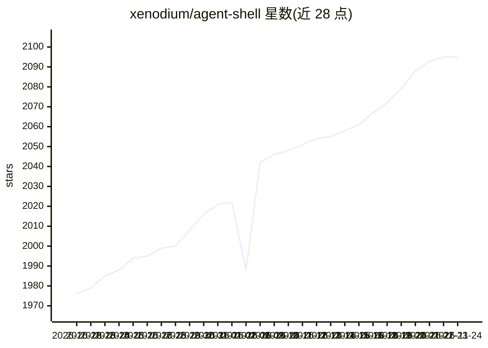

# xenodium/agent-shell

⭐ 2,095 · Emacs Lisp · GPL-3.0 · 推送 2026-11-20 · [GitHub](https://github.com/xenodium/agent-shell) · [官网](https://xenodium.com) · 个人维护

**在 Emacs 中接入 24 个 ACP AI agent 的客户端**

一个 Emacs 包（MELPA 提供），基于 Agent Client Protocol（ACP）通过 acp.el 与 AI agent 通信，把 agent 会话放入 Emacs 原生 buffer 与键位绑定中，不依赖终端模拟。README 列出 24 个兼容 agent（Claude Agent、Codex、Gemini CLI、Goose 等），各 agent 需单独安装对应 CLI/适配器并加入 PATH；另有 30 余个社区扩展包及系列博客说明功能演进。安装依赖 Node 生态的 npm 全局包（如 claude-agent-acp、codex-acp）。

## 筛选速览

| 维度 | 判定 | 备注 |
|---|---|---|
| AI 角色 | `ai-ecosystem` | LLM/agent 周边工具 |
| 许可风险 | `viral` | GPL-3.0 |
| 部署形态 | `self-host` | docker 或自建部署 |
| 模型依赖 | local-ok | 支持本地模型 |
| 硬件要求 | — | 无带数字的原话,不猜 |
| 安装摩擦 | `low` | 无编译、无系统依赖或容器化 |
| 成熟度 | — | 结构信号不足 |

## 能力要点

- 通过 ACP 协议支持 24 个 agent 及任意 ACP 兼容 agent
- 在 Emacs 原生 buffer 中运行，无终端模拟
- 依赖 acp.el 处理 agent 通信
- 30 余个社区扩展包（会话管理、通知、Docker 沙箱运行等）

## 适用场景

- 在 Emacs 工作流中直接与 Claude Agent / Codex / Gemini CLI 等 agent 交互
- 统一界面管理多个 AI 编码 agent 会话
- 通过社区包实现多 agent 协调、会话恢复与代码审查

## 场景标签

`编码 Agent` · 领域:编码与开发

## 证据(README 行号)

> L20: =agent-shell= brings your favorite AI agents to [[https://www.gnu.org/software/emacs/][Emacs]], keeping you at home
> L22: Works with 24 agents today, and any other that speaks ACP:
> L84: =agent-shell= relies on [[https://github.com/xenodium/acp.el][acp.el]] to communicate with agents via ACP ([[https:

## 星数曲线

2026-10-22 1,976 → 2026-11-24 2,095（+119）

---
*卡片 v1 · prompt 1.4 · 生成 2026-11-23 · 置信度 mid · 依据 README sha `a88c670ed1b5` · [字段定义](../../DATASET.md)*
