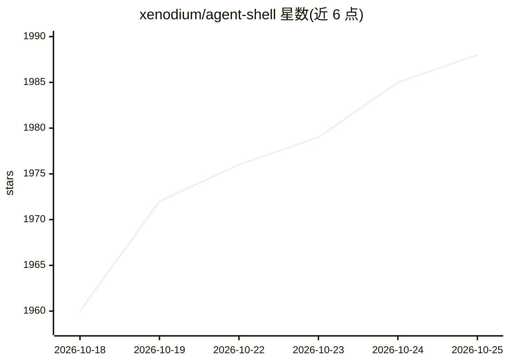

# xenodium/agent-shell

⭐ 1,994 · Emacs Lisp · GPL-3.0 · 推送 2026-10-25 · [GitHub](https://github.com/xenodium/agent-shell) · [官网](https://xenodium.com) · 个人维护

**在 Emacs 缓冲区中接入多种 AI 编码 agent 的 ACP 客户端**

Emacs Lisp 包，通过 ACP（Agent Client Protocol）将 Claude Agent、Codex、Gemini CLI、Goose、Grok Build 等 23 个 AI agent 引入 Emacs，以原生缓冲区和快捷键交互，不做终端模拟。依赖 acp.el 与各 agent 自身的 CLI/ACP 适配器（多为 npm 全局安装或各官方安装脚本），经 MELPA 分发，另有社区开发的侧栏、队列、通知等约 25 个扩展包。

## 筛选速览

| 维度 | 判定 | 备注 |
|---|---|---|
| AI 角色 | `ai-ecosystem` | LLM/agent 周边工具 |
| 许可风险 | `viral` | GPL-3.0 |
| 部署形态 | `self-host` | docker 或自建部署 |
| 模型依赖 | — | README 未给出锁定关系 |
| 硬件要求 | — | 无带数字的原话,不猜 |
| 安装摩擦 | `low` | 无编译、无系统依赖或容器化 |
| 成熟度 | — | 结构信号不足 |

## 能力要点

- 支持 23 个 agent 及任何讲 ACP 的其他 agent
- 原生 Emacs 缓冲区与快捷键交互，无终端模拟
- 依赖 acp.el 通过 ACP 与 agent 通信
- 周边有约 25 个社区扩展包（侧栏/队列/通知/Org 集成等）

## 适用场景

- 在 Emacs 内直接与 Claude、Codex、Gemini 等 AI 编码 agent 对话
- 用熟悉的 Emacs 工作流运行多个 agent 会话
- 通过社区扩展（队列/侧栏/Org 转录）组织 agent 工作流

## 场景标签

`编码 Agent` · 领域:编码与开发

## 证据(README 行号)

> L20: =agent-shell= brings your favorite AI agents to [[https://www.gnu.org/software/emacs/][Emacs]], keeping you at home
> L79: =agent-shell= relies on [[https://github.com/xenodium/acp.el][acp.el]] to communicate with agents via ACP ([[https:
> L22: Works with 23 agents today, and any other that speaks ACP:

## 星数曲线

2026-10-18 1,960 → 2026-10-25 1,988（+28）

---
*卡片 v1 · prompt 1.4 · 生成 2026-10-21 · 置信度 mid · 依据 README sha `c8bf342d96c5` · [字段定义](../../DATASET.md)*
