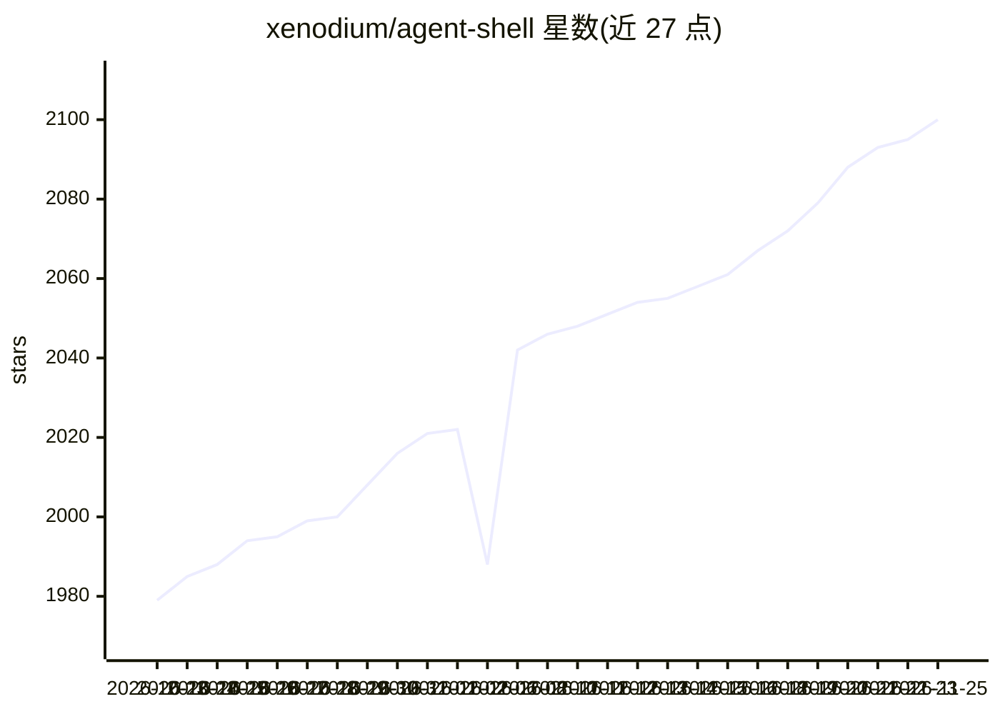

# xenodium/agent-shell

⭐ 2,100 · Emacs Lisp · GPL-3.0 · 推送 2026-11-24 · [GitHub](https://github.com/xenodium/agent-shell) · [官网](https://xenodium.com) · 个人维护

**给 Emacs 用户的 AI Agent 接入层：用 ACP 在编辑器内运行 24 种 agent**

agent-shell 是一个 Emacs 包（通过 MELPA 分发），基于 Agent Client Protocol（ACP）在 Emacs 缓冲区中运行各类 AI coding agent，保持原生缓冲区与按键绑定，不依赖终端模拟。README 列出 24 个可接入的 agent（Claude Agent、Codex、Gemini CLI、Goose、Cursor 等），并说明各 agent 需单独安装其 CLI/ACP 适配器并置于 PATH。依赖 acp.el 与 agent 通信；另有大量社区扩展包（会话管理、通知、Org 集成等）。接入的 agent 本身需用户自行付费获取 LLM token。

## 筛选速览

| 维度 | 判定 | 备注 |
|---|---|---|
| AI 角色 | `ai-ecosystem` | LLM/agent 周边工具 |
| 许可风险 | `viral` | GPL-3.0 |
| 部署形态 | `self-host` | docker 或自建部署 |
| 模型依赖 | — | README 未给出锁定关系 |
| 硬件要求 | — | 无带数字的原话,不猜 |
| 安装摩擦 | `low` | 无编译、无系统依赖或容器化 |
| 成熟度 | — | 结构信号不足 |

## 能力要点

- 通过 ACP 协议接入 24 个 agent，以及任何支持 ACP 的 agent
- 使用 Emacs 原生缓冲区与按键绑定，无终端模拟
- 依赖 acp.el 处理与 agent 的 ACP 通信
- 围绕本包形成了多个社区扩展（沙箱 Docker 运行、多 agent 协调、会话恢复等）

## 适用场景

- 在 Emacs 内直接与 Claude/Codex/Gemini 等 coding agent 交互
- 统一管理多个 AI agent 会话而不切换终端
- 通过 Org Babel 或社区扩展把 agent 会话融入既有 Emacs 工作流

## 场景标签

`编码 Agent` · 领域:编码与开发

## 证据(README 行号)

> L20: =agent-shell= brings your favorite AI agents to [[https://www.gnu.org/software/emacs/][Emacs]], keeping you at home
> L22: Works with 24 agents today, and any other that speaks ACP:
> L84: =agent-shell= relies on [[https://github.com/xenodium/acp.el][acp.el]] to communicate with agents via ACP ([[https:

## 星数曲线

2026-10-23 1,979 → 2026-11-25 2,100（+121）

---
*卡片 v1 · prompt 1.4 · 生成 2026-11-24 · 置信度 mid · 依据 README sha `53d7779e38f8` · [字段定义](../../DATASET.md)*
