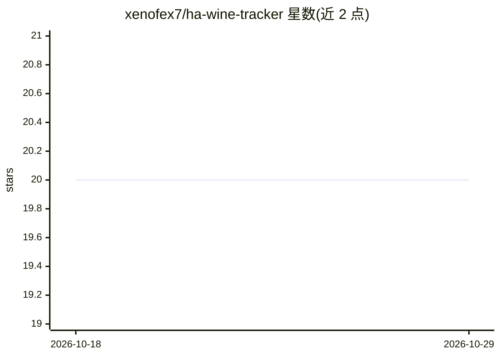

# xenofex7/ha-wine-tracker

⭐ 20 · Python · MIT · 推送 2026-10-19 · [GitHub](https://github.com/xenofex7/ha-wine-tracker) · [官网](https://xenofex7.github.io/ha-wine-tracker) · 个人维护

**酒窖管理应用：AI 识别酒标并整合 Vivino 数据**

面向葡萄酒收藏者的酒窖管理应用，以 Home Assistant 插件或独立 Docker 容器两种方式部署。核心流程：拍摄酒标照片后由 AI（Anthropic/OpenAI/OpenRouter/Ollama/MiniMax/Mistral 六家可选）填充年份、产区、品种、成熟期、口感画像与配餐建议等字段；也可通过 Vivino 按名称导入评分与价格。附带 AI 侍酒师聊天（可在对话中对酒窖增删改）、多视图/筛选/统计、REST API 供 Home Assistant 传感器使用。AI 功能可选，无 API key 时 Vivino 检索仍可用。

## 筛选速览

| 维度 | 判定 | 备注 |
|---|---|---|
| AI 角色 | `ai-enhanced` | 去掉 AI 部分产品仍成立 |
| 许可风险 | `permissive` | MIT |
| 部署形态 | `self-host` | docker 或自建部署 |
| 模型依赖 | local-ok | 支持本地模型 |
| 硬件要求 | — | 无带数字的原话,不猜 |
| 安装摩擦 | `low` | 无编译、无系统依赖或容器化 |
| 成熟度 | — | 结构信号不足 |

## 能力要点

- AI 识别酒标并自动填充成熟期、口感画像与配餐建议
- 支持 Anthropic/OpenAI/OpenRouter/Ollama/MiniMax/Mistral 六个 AI 提供方，Ollama 可全本地运行
- Vivino 按名称搜索导入评分与价格，无需账号
- AI 侍酒师聊天支持在对话中对酒窖做增删改操作

## 适用场景

- 拍一张酒标照片就录入一瓶酒的全部信息
- 追踪库存、饮用窗口和酒窖总值变化
- 把酒窖数据接入 Home Assistant 仪表盘

## 场景标签

`聊天机器人` `图像视频处理` · 领域:对话与助手

## 证据(README 行号)

> L14: Wine Tracker manages your wine cellar from label photo to tasting note. Snap a
> L16: prices, then track bottles, drink windows and value over time. It runs as a
> L17: Home Assistant add-on in the HA sidebar, or as a standalone Docker container

## 星数曲线

2026-10-18 20 → 2026-10-29 20（+0）

---
*卡片 v1 · prompt 1.4 · 生成 2026-10-28 · 置信度 mid · 依据 README sha `853a28d2b1d8` · [字段定义](../../DATASET.md)*
