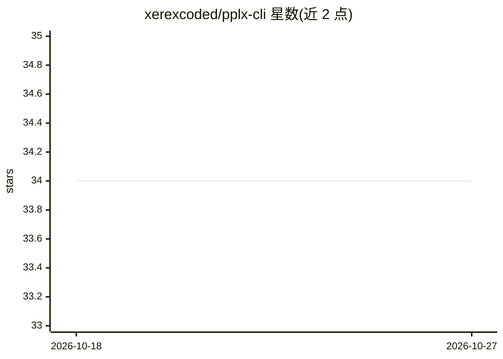

# xerexcoded/pplx-cli

⭐ 34 · Python · MIT · 推送 2026-10-17 · [GitHub](https://github.com/xerexcoded/pplx-cli) · [官网](https://xerexcoded.github.io/pplx-cli-landing/) · 个人维护

**接 Perplexity/NVIDIA NIM/OpenRouter 的 CLI，带本地 RAG 与 LLM Wiki**

基于 Typer 的命令行工具，支持配置 Perplexity Sonar、NVIDIA NIM、OpenRouter 三家作为聊天提供方。本地知识部分：默认用 BGE 嵌入与 SQLite FTS5 做证据优先 RAG，混合检索采用 Reciprocal Rank Fusion，sqlite-vec 可用时走原生 KNN，否则精确回退；提供 Markdown/文本 PDF/网页的 Wiki 编译（保留引用与来源定位）、只读 MCP 工具（wiki_search 等）与召回评测（Recall@k/MRR/nDCG）；另含 Obsidian 式知识图谱可视化与聊天记录导出。处理默认本地，聊天需各提供方 API key。

## 筛选速览

| 维度 | 判定 | 备注 |
|---|---|---|
| AI 角色 | `ai-native` | 本体是模型或模型工具 |
| 许可风险 | `permissive` | MIT |
| 部署形态 | `library` | 以包/库形式分发 |
| 模型依赖 | locked-api |  |
| 硬件要求 | — | 无带数字的原话,不猜 |
| 安装摩擦 | `low` | 无编译、无系统依赖或容器化 |
| 成熟度 | — | 结构信号不足 |

## 能力要点

- 三提供方（Perplexity/NVIDIA NIM/OpenRouter）统一 CLI 聊天，setup 交互式配置
- 默认 BGE 本地嵌入 + FTS5 混合检索（RRF 融合），离线可用
- LLM Wiki：编译 Markdown/PDF/网页为带引用的页面，源文件不动
- 提供只读 MCP 工具与检索评测报告（Recall@k、MRR、nDCG）

## 适用场景

- 在终端直接向 Perplexity/NIM/OpenRouter 模型提问
- 把本地笔记与聊天历史建成可检索的个人知识库
- 把研究资料目录编译成带引用与来源定位的 Markdown wiki
- 可视化 Obsidian 式 Markdown 库为交互知识图谱

## 场景标签

`知识库管理` `RAG` `科研工具` · 领域:知识与检索

## 证据(README 行号)

> L3: A command-line interface for Perplexity, NVIDIA NIM, and OpenRouter with local notes, evidence-first RAG, and a Mark
> L11: - 🤖 **Multi-Provider AI Chat**: Use Perplexity Sonar, NVIDIA NIM, or OpenRouter models with one CLI
> L248: Ask your configured provider directly:

## 星数曲线

2026-10-18 34 → 2026-10-27 34（+0）

---
*卡片 v1 · prompt 1.4 · 生成 2026-10-25 · 置信度 high · 依据 README sha `91fc7c515713` · [字段定义](../../DATASET.md)*
