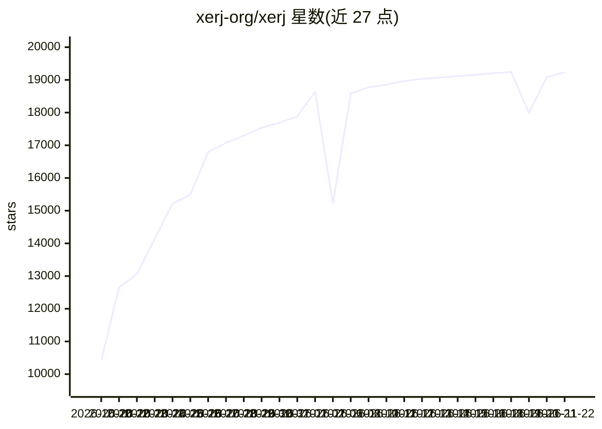

# xerj-org/xerj

⭐ 19,239 · Rust · Apache-2.0 · 推送 2026-11-21 · [GitHub](https://github.com/xerj-org/xerj) · [官网](https://xerj.org) · 组织维护

**给 AI agent 用的本地搜索引擎与 MCP 服务器，单二进制**

单 Rust 二进制实现的本地搜索引擎与 MCP 服务器，索引代码、文档、日志、JSONL/CSV、PDF，提供 BM25、向量与混合检索、tree-sitter 代码搜索和 /_memory agent 记忆，暴露 Elasticsearch 兼容 API。rc.101 加入 XERJ Query-1 模型（默认关闭），把问题编译为对已存事实的小程序并引用事实来源。面向使用 Claude Code、Cursor 等 MCP 客户端的开发者，主打参考编码场景；引擎源码为 Apache-2.0，rc.101 起模型 crates 专有。

## 筛选速览

| 维度 | 判定 | 备注 |
|---|---|---|
| AI 角色 | `ai-ecosystem` | LLM/agent 周边工具 |
| 许可风险 | `permissive` | Apache-2.0 |
| 部署形态 | `desktop` | 安装包/桌面程序 |
| 模型依赖 | — | README 未给出锁定关系 |
| 硬件要求 | `cpu-ok` | |
| 安装摩擦 | `medium` | 含编译或系统依赖之一 |
| 成熟度 | — | 结构信号不足 |

## 能力要点

- 单二进制提供 BM25、向量与混合检索及代码搜索
- Elasticsearch 兼容 API，无 JVM 依赖
- /_memory 与 MCP 工具接入 Claude Code、Cursor 等客户端
- autoindex 自动索引任意文件夹为类型化索引

## 适用场景

- 让编码 agent 检索参考开源代码再写代码，减少 token 消耗
- 为本地仓库做带 file:line 引用的问答与 RAG
- 索引目标代码树做安全审计
- 把混合格式日志建成可聚合的类型化索引

## 场景标签

`Agent 记忆` `语义搜索` · 领域:Agent 开发

## 证据(README 行号)

> L97: **Local-first search engine and MCP server for AI agents.** One Rust binary indexes code, docs,
> L99: memory, behind an Elasticsearch-compatible API. Works with Claude Code, Cursor and any MCP client.
> L33:  Why XERJ, built for agents: search, memory and a familiar API in one Rust binary. Reference coding: 2.7 times fewe

## 星数曲线

2026-10-20 10,418 → 2026-11-22 19,239（+8,821）

---
*卡片 v1 · prompt 1.4 · 生成 2026-11-22 · 置信度 mid · 依据 README sha `16d4250d15ba` · [字段定义](../../DATASET.md)*
