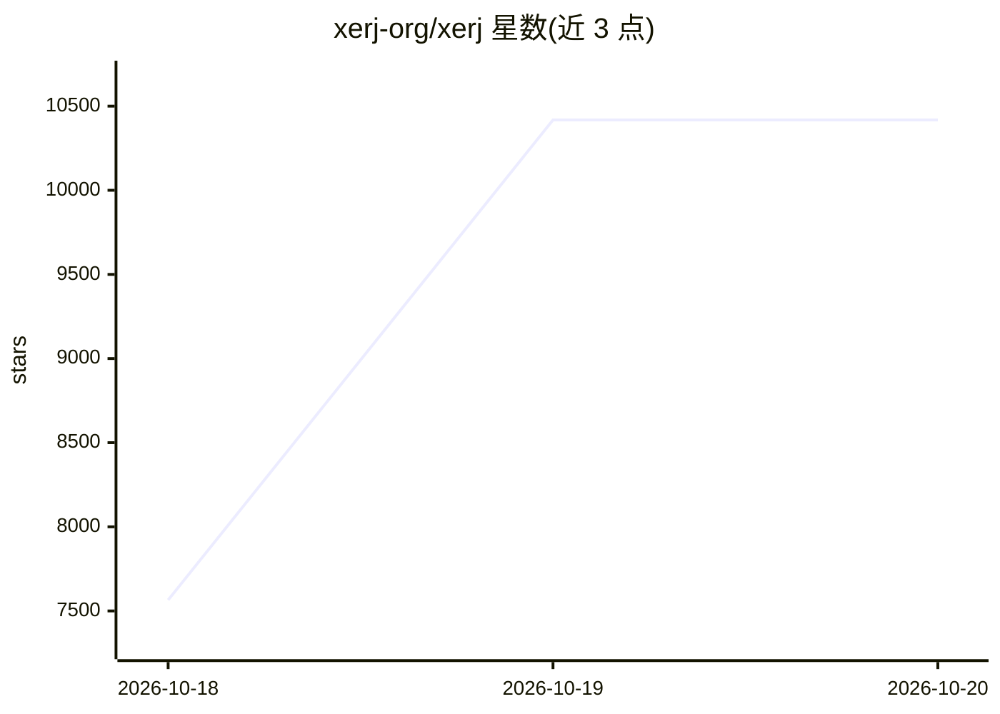

# xerj-org/xerj

⭐ 10,418 · Rust · Apache-2.0 · 推送 2026-10-19 · [GitHub](https://github.com/xerj-org/xerj) · [官网](https://xerj.org) · 组织维护

**本地 AI 搜索引擎：一条命令索引任意文件夹供 agent 检索**

Rust 编写的本地搜索引擎，以单一静态二进制分发。`xerj autoindex` 自动嗅探文件类型并为代码（经 tree-sitter 提取符号与行号）、CSV、PDF、SQLite、日志、Unity 资产等建立可查询索引，无需编写 schema。对外暴露 Elasticsearch API，现有客户端与仪表盘可直接使用，支持向量与混合检索，并提供 `/_memory` 命名空间作为 agent 长期记忆。主要面向编程 agent 的 reference coding 用例：索引相近开源仓库后按段落检索以替代逐文件读取。默认 `--insecure` 模式仅适用于单用户开发机，关闭 TLS 与认证后任意可访问端口者均为超级用户。

## 筛选速览

| 维度 | 判定 | 备注 |
|---|---|---|
| AI 角色 | `ai-ecosystem` | LLM/agent 周边工具 |
| 许可风险 | `permissive` | Apache-2.0 |
| 部署形态 | `None` |  |
| 模型依赖 | — | README 未给出锁定关系 |
| 硬件要求 | — | 无带数字的原话,不猜 |
| 安装摩擦 | `medium` | 含编译或系统依赖之一 |
| 成熟度 | — | 结构信号不足 |

## 能力要点

- 一条命令 autoindex 多种文件格式为类型化索引，无需 schema
- 兼容 Elasticsearch API，现有客户端可直接连接 localhost:9200
- tree-sitter 提取代码符号与行号，检索返回 file:line
- `/_memory/{namespace}` 提供 agent 长期记忆，按语义召回

## 适用场景

- 让编程 agent 检索相似开源仓库的实现方式再写代码
- 对代码库做问答与 RAG，直接取到带 file:line 的段落
- 索引日志与混合格式数据做事件分析或安全审计

## 场景标签

`语义搜索` `RAG` `Agent 记忆` · 领域:Agent 开发

## 证据(README 行号)

> L27: XERJ is a community-trusted local AI search that indexes any folder automatically, so your
> L109: awkward CSVs into typed, queryable indices for search, RAG, security audits and agent
> L189: and arm64. You can also build from source. It speaks the Elasticsearch

## 星数曲线

2026-10-18 7,565 → 2026-10-20 10,418（+2,853）

---
*卡片 v1 · prompt 1.4 · 生成 2026-10-20 · 置信度 high · 依据 README sha `94f1bf85600e` · [字段定义](../../DATASET.md)*
