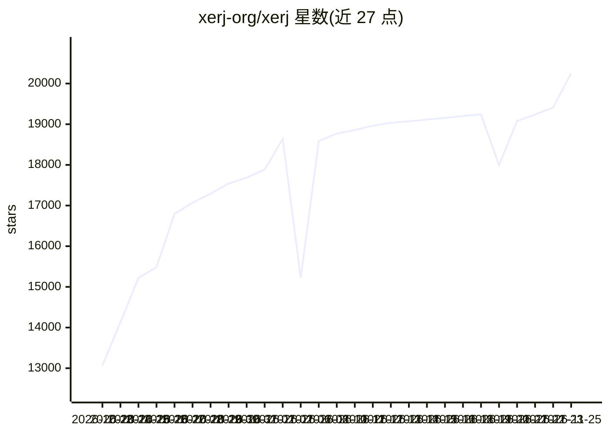

# xerj-org/xerj

⭐ 20,257 · Rust · Apache-2.0 · 推送 2026-11-24 · [GitHub](https://github.com/xerj-org/xerj) · [官网](https://xerj.org) · 组织维护 · 中文 README

**面向 agent 的本地搜索引擎：一个 Rust 二进制提供检索、记忆与 MCP**

单二进制的本地搜索引擎与 MCP 服务器，自动索引代码、文档、日志、JSONL/CSV、PDF 与 SQLite，提供 BM25、向量与混合检索、基于 tree-sitter 的代码搜索及 /_memory agent 记忆，API 与 Elasticsearch 兼容。主打参考编码场景，通过 xerj init 接入 Claude Code/Cursor。rc.101 起附带的 Query-1 模型以闭源 crate 形式发布，仓库源码不含该功能；--insecure 关闭全部认证仅限本机使用。

## 筛选速览

| 维度 | 判定 | 备注 |
|---|---|---|
| AI 角色 | `ai-ecosystem` | LLM/agent 周边工具 |
| 许可风险 | `permissive` | Apache-2.0 |
| 部署形态 | `desktop` | 安装包/桌面程序 |
| 模型依赖 | — | README 未给出锁定关系 |
| 硬件要求 | `cpu-ok` | |
| 安装摩擦 | `medium` | 含编译或系统依赖之一 |
| 成熟度 | — | 结构信号不足 |

## 能力要点

- 单 Rust 二进制，支持 BM25/向量/混合检索与代码搜索
- Elasticsearch 兼容 API，无需 JVM
- /_memory 命名空间与 MCP 工具对接 agent 记忆
- xerj autoindex 自动识别文件类型建索引

## 适用场景

- 给编码 agent 建立参考编码索引，减少逐文件读取消耗
- 为 agent 提供本地 RAG 检索后端
- 作为无需 JVM 的 Elasticsearch 替代运行
- 批量检索多个 ID 并带引用返回结果

## 场景标签

`Agent 记忆` `RAG` `语义搜索` · 领域:Agent 开发

## 证据(README 行号)

> L33:  Why XERJ, built for agents: search, memory and a familiar API in one Rust binary. Reference coding: 2.7 times fewe
> L102: **Local-first search engine and MCP server for AI agents.** One Rust binary indexes code, docs,
> L104: memory, behind an Elasticsearch-compatible API. Works with Claude Code, Cursor and any MCP client.

## 星数曲线

2026-10-23 13,066 → 2026-11-25 20,257（+7,191）

---
*卡片 v1 · prompt 1.4 · 生成 2026-11-23 · 置信度 mid · 依据 README sha `066628b7490c` · [字段定义](../../DATASET.md)*
