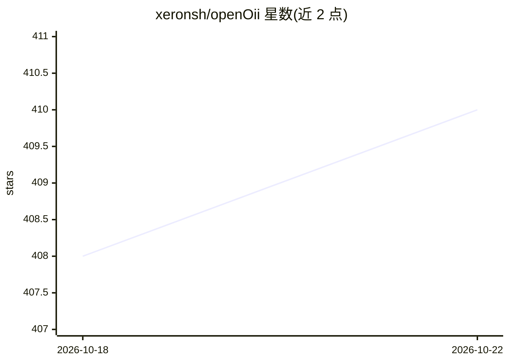

# xeronsh/openOii

⭐ 411 · Python · 推送 2026-09-27 · [GitHub](https://github.com/xeronsh/openOii) · 个人维护 · 中文 README

**把故事创意经多智能体流水线生成漫剧成片的学习项目**

基于 LangGraph 的 AI 漫剧生成平台：将故事创意串联为规划、角色/分镜生成、视频生成与合成四个阶段，通过 WebSocket 推送实时进度，支持可恢复、可取消、可反馈的 run 流程，并用 tldraw 无限画布审阅角色、分镜与结果。前端为 React 18 + TypeScript，后端 FastAPI + SQLModel + LangGraph，基础设施依赖 PostgreSQL 与 Redis。README 明确声明这是学习/演示项目，不适合直接用于工业生产环境。

## 筛选速览

| 维度 | 判定 | 备注 |
|---|---|---|
| AI 角色 | `ai-native` | 本体是模型或模型工具 |
| 许可风险 | `none` | — |
| 部署形态 | `self-host` | docker 或自建部署 |
| 模型依赖 | — | README 未给出锁定关系 |
| 硬件要求 | — | 无带数字的原话,不猜 |
| 安装摩擦 | `low` | 无编译、无系统依赖或容器化 |
| 成熟度 | `idea` | |

## 能力要点

- 故事创意到漫剧成片的多阶段 AI 生成链路
- WebSocket 实时进度，支持可恢复/可取消/可反馈的 run 流程
- tldraw 无限画布审阅角色、分镜与结果
- 前端环境变量配置面板在线管理模型与基础服务

## 适用场景

- 学习 LangGraph 多阶段编排与恢复执行的实现方式
- 体验从故事创意到分镜、视频生成的多智能体流水线
- 在无限画布上审阅 AI 生成的角色与分镜

## 场景标签

 · 领域:AIGC/多智能体应用

## 证据(README 行号)

> L5:  故事想法 → 多智能体协作 → 漫剧成片
> L34: openOii 把故事创意串成 **规划、角色/分镜生成、视频生成与合成** 的完整链路，并用无限画布展示过程与结果。

## 星数曲线

2026-10-18 408 → 2026-10-22 410（+2）

---
*卡片 v1 · prompt 1.4 · 生成 2026-10-21 · 置信度 high · 依据 README sha `f7080351c893` · [字段定义](../../DATASET.md)*
