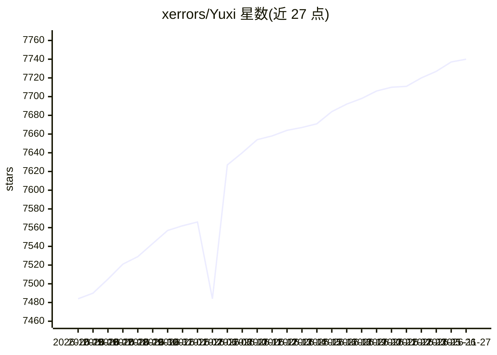

# xerrors/Yuxi

⭐ 7,740 · Python · MIT · 推送 2026-11-26 · [GitHub](https://github.com/xerrors/Yuxi) · [官网](https://xerrors.github.io/Yuxi/) · 个人维护 · 中文 README

**企业自托管智能体基座：统一 RAG、知识图谱与多智能体**

Yuxi 是可私有部署的多租户企业智能体平台：团队将内部资料建成知识库（支持解析、分块、向量与关键词混合检索），可从索引文档块构建 Neo4j 知识图谱，并支持 RAG 评估与问答集生成；智能体可将任务分给子智能体、调用工具与 MCP/Skills 扩展、在沙盒中执行命令并交付文件。管理员按用户与部门划分权限、配置模型供应商与凭据、查看 Token 用量看板；业务系统通过 Agents API 接入，外部助手经知识库 MCP 检索。通过 Docker Compose 部署，需 SiliconFlow API Key 初始化。

## 筛选速览

| 维度 | 判定 | 备注 |
|---|---|---|
| AI 角色 | `ai-ecosystem` | LLM/agent 周边工具 |
| 许可风险 | `permissive` | MIT |
| 部署形态 | `self-host` | docker 或自建部署 |
| 模型依赖 | — | README 未给出锁定关系 |
| 硬件要求 | — | 无带数字的原话,不猜 |
| 安装摩擦 | `low` | 无编译、无系统依赖或容器化 |
| 成熟度 | — | 结构信号不足 |

## 能力要点

- 自建 Milvus 知识库支持混合检索，可构建 Neo4j 知识图谱
- 多智能体编排：子智能体分工、沙盒执行命令、人工审批
- Skills 与 MCP 工具扩展，知识库 MCP 供外部助手检索
- 多租户权限管理、模型供应商凭据配置与用量看板

## 适用场景

- 把企业制度、产品手册建成可溯源引用的知识库问答
- 把多步调研分析任务交给智能体并取回报告文件
- 为部门共享配置专用智能体并按权限管控资源
- 让外部助手通过 MCP 在授权范围内检索企业知识

## 场景标签

`多智能体` `文档问答` `知识图谱` `RAG` · 领域:Agent 开发

## 证据(README 行号)

> L3: **Yuxi 是可私有部署的企业智能体基座。** 团队可以把内部资料、常用工具和工作方法配置成专用智能体，由管理员共享给相应的成员或部门。成员使用同一个智能体，各自按权限查资料、核对出处，也可以把调研或分析任务交给它，在项目工作区取
> L19: - **让团队复用自己的智能体。** 把工作方法写成 Skills，为智能体选择模型、知识库和工具，再设置共享范围。员工从 Web 工作台使用，已有业务系统通过 Agents API 创建会话、提交任务并读取结果。
> L21: ## 系统架构

## 星数曲线

2026-10-25 7,484 → 2026-11-27 7,740（+256）

---
*卡片 v1 · prompt 1.4 · 生成 2026-11-26 · 置信度 high · 依据 README sha `41147d6e9984` · [字段定义](../../DATASET.md)*
