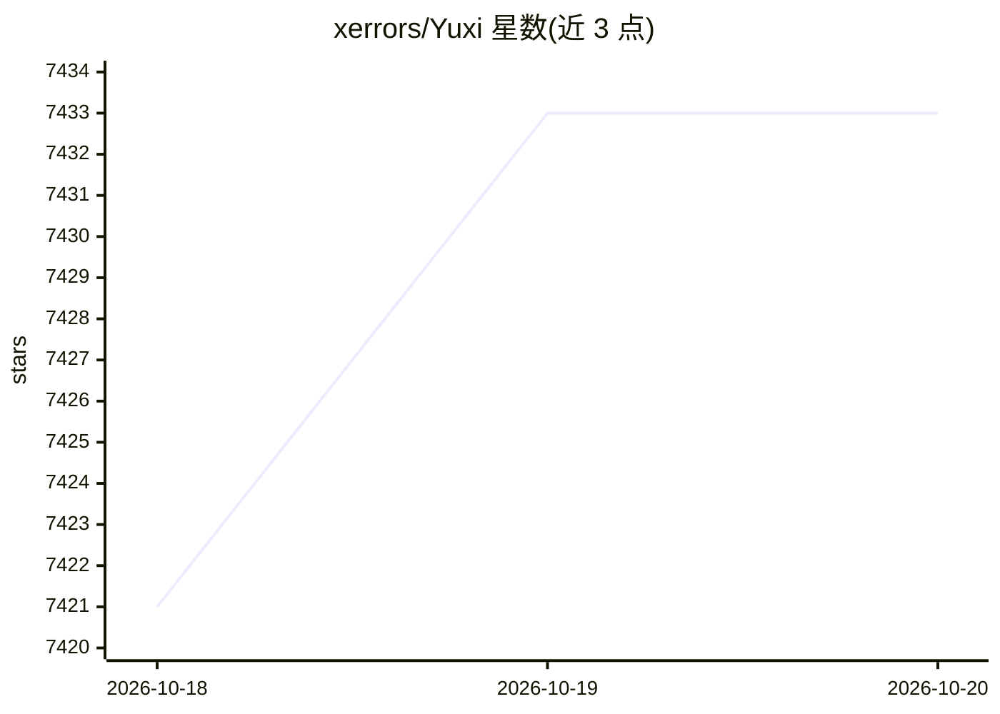

# xerrors/Yuxi

⭐ 7,433 · Python · MIT · 推送 2026-10-19 · [GitHub](https://github.com/xerrors/Yuxi) · [官网](https://xerrors.github.io/Yuxi/) · 个人维护 · 中文 README

**可私有部署的多租户知识智能体平台，自托管 RAG 与多智能体**

Yuxi 是面向需要自部署、自控数据/模型/权限的企业团队的多用户知识智能体平台：将 Agentic RAG（文档解析、分块、向量索引、多路召回与 Rerank、RAG 评估）、Milvus/Neo4j 知识图谱构建、LangGraph 多智能体编排、SubAgents/Skills/MCP 扩展、沙盒文件工作区与多租户权限管理集成于同一工作区。完全基于 Docker Compose 启动，服务包含 LangGraph、Vue、FastAPI、Milvus、Neo4j、PostgreSQL、MinerU、PaddleOCR；需自备大模型 API。支持接入 OpenAI、Anthropic、DeepSeek、Qwen 及 OpenAI 兼容端点（如 vLLM）。MIT 协议。

## 筛选速览

| 维度 | 判定 | 备注 |
|---|---|---|
| AI 角色 | `ai-ecosystem` | LLM/agent 周边工具 |
| 许可风险 | `permissive` | MIT |
| 部署形态 | `self-host` | docker 或自建部署 |
| 模型依赖 | — | README 未给出锁定关系 |
| 硬件要求 | — | 无带数字的原话,不猜 |
| 安装摩擦 | `low` | 无编译、无系统依赖或容器化 |
| 成熟度 | — | 结构信号不足 |

## 能力要点

- Agentic RAG 套件：多格式入库、Embedding/Rerank、检索测试与基准评估
- 从文档块抽取实体关系写入 Neo4j 构建知识图谱参与检索
- 多智能体编排：SubAgents 并行、Skills、MCP、沙盒工具与人工审批
- 多租户权限体系与统一模型凭据管理、Dashboard 运行监控

## 适用场景

- 企业私有部署团队知识库问答与 Agent 工作台
- 结合知识图谱做多跳检索与深度调研任务
- 通过沙盒让智能体产出可预览下载的报告与文件产物

## 场景标签

`RAG` `文档问答` `知识图谱` `多智能体` · 领域:Agent 开发

## 证据(README 行号)

> L3: **Yuxi = Cloud Agents + Knowledge RAG**，Yuxi 是一个可私有部署的多租户知识智能体平台。自定义智能体，权限可控，沉淀企业轨迹。它把知识库检索、知识图谱、LangGraph 多智能体编排、MC
> L17: Yuxi 是面向需要企业自部署的多用户 Agent 产品，且需要自己掌握数据、模型和权限的团队：

## 星数曲线

2026-10-18 7,421 → 2026-10-20 7,433（+12）

---
*卡片 v1 · prompt 1.4 · 生成 2026-10-20 · 置信度 high · 依据 README sha `479f1b8384ed` · [字段定义](../../DATASET.md)*
