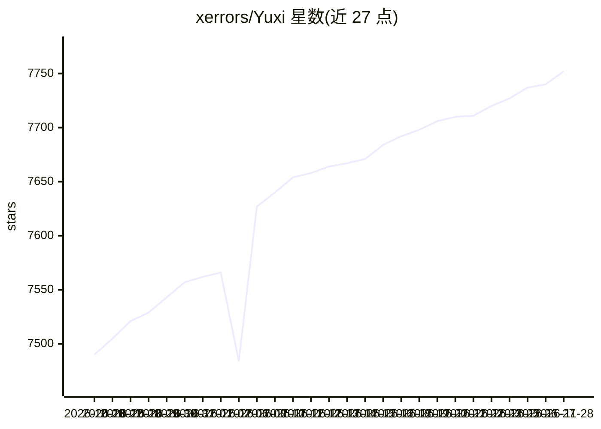

# xerrors/Yuxi

⭐ 7,752 · Python · MIT · 推送 2026-11-27 · [GitHub](https://github.com/xerrors/Yuxi) · [官网](https://xerrors.github.io/Yuxi/) · 个人维护 · 中文 README

**可私有部署的多租户企业智能体基座，含 RAG 与多智能体**

面向团队的私有部署智能体平台：将企业资料建成知识库（支持混合检索、Neo4j 知识图谱、RAG 评估），智能体可拆分子智能体、调用工具并在沙盒中执行命令，产物以文件形式交付到工作区。提供 Skills 编写、MCP 工具接入、Agents API 供业务系统调用，管理员可按部门划分权限并查看 Token 用量。安装依赖 Docker Compose 与模型 API Key，本体以 MIT 许可发布。

## 筛选速览

| 维度 | 判定 | 备注 |
|---|---|---|
| AI 角色 | `ai-ecosystem` | LLM/agent 周边工具 |
| 许可风险 | `permissive` | MIT |
| 部署形态 | `self-host` | docker 或自建部署 |
| 模型依赖 | — | README 未给出锁定关系 |
| 硬件要求 | — | 无带数字的原话,不猜 |
| 安装摩擦 | `low` | 无编译、无系统依赖或容器化 |
| 成熟度 | — | 结构信号不足 |

## 能力要点

- 知识库支持解析、分块、向量与关键词混合检索，引用可回溯原文
- 多智能体编排：任务分配子智能体、沙盒执行、人工审批
- Skills 与 MCP 工具扩展，Agents API 供业务系统集成
- 多租户权限管理与模型用量看板

## 适用场景

- 把制度、产品手册建成团队可检索的知识库
- 让智能体执行多步调研并交付报告文件
- 通过 Agents API 把智能体嵌入现有业务系统
- 让外部助手经知识库 MCP 检索企业资料

## 场景标签

`RAG` `多智能体` `Agent 框架` · 领域:Agent 开发

## 证据(README 行号)

> L3: **Yuxi 是可私有部署的企业智能体基座。** 团队可以把内部资料、常用工具和工作方法配置成专用智能体，由管理员共享给相应的成员或部门。成员使用同一个智能体，各自按权限查资料、核对出处，也可以把调研或分析任务交给它，在项目工作区取
> L19: - **让团队复用自己的智能体。** 把工作方法写成 Skills，为智能体选择模型、知识库和工具，再设置共享范围。员工从 Web 工作台使用，已有业务系统通过 Agents API 创建会话、提交任务并读取结果。

## 星数曲线

2026-10-26 7,490 → 2026-11-28 7,752（+262）

---
*卡片 v1 · prompt 1.4 · 生成 2026-11-28 · 置信度 high · 依据 README sha `f1494746f4f8` · [字段定义](../../DATASET.md)*
