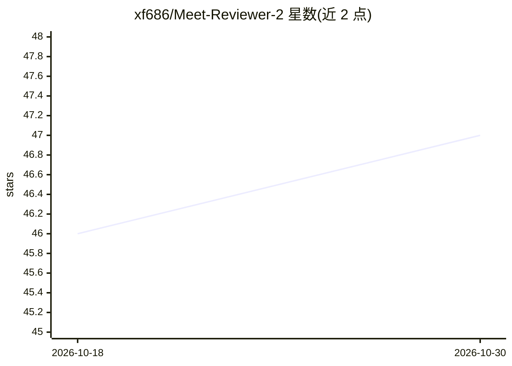

# xf686/Meet-Reviewer-2

⭐ 47 · MIT · 推送 2026-06-23 · [GitHub](https://github.com/xf686/Meet-Reviewer-2) · 个人维护 · 中文 README

**投稿前模拟同行评审小组的 Claude Code 技能**

一个 Claude Code 技能（skill）：读取论文草稿（.pdf/.tex/.md/arXiv 链接/粘贴文本），模拟由 R1 拥护者、R2 方法怀疑论者、R3/AC 新意鹰派组成的审稿小组，输出模拟评审、AC 综合评审（含预测结局 Reject/Borderline/Accept）与按影响×成本排序的修补清单。评审框架基于 NeurIPS/ICLR/ACL 官方审稿指南与 2,956 份 ICLR 2024 真实评审，批评须钉到草稿具体位置并过 ACL H1–H17 不正当批评黑名单。另有 B 模式产出可提交的正式评审。以插件或手动拷贝技能目录方式安装，MIT 许可。

## 筛选速览

| 维度 | 判定 | 备注 |
|---|---|---|
| AI 角色 | `ai-native` | 本体是模型或模型工具 |
| 许可风险 | `permissive` | MIT |
| 部署形态 | `None` |  |
| 模型依赖 | — | README 未给出锁定关系 |
| 硬件要求 | — | 无带数字的原话,不猜 |
| 安装摩擦 | `low` | 无编译、无系统依赖或容器化 |
| 成熟度 | — | 结构信号不足 |

## 能力要点

- 三位角色分工的模拟审稿小组+AC 综合评审与预测结局
- 批评必须钉到草稿具体位置（§/表/引文），无实质问题时拒绝硬编
- 评审维度蒸馏自 2,956 份 ICLR 2024 真实评审，过 ACL H1–17 不正当批评黑名单
- 区分实质问题/会被误读/打磨三类，修补清单按影响×成本排序

## 适用场景

- 投稿前预演同行评审，提前修补会被 Reviewer 2 攻击的弱点
- 被指派审稿或帮导师审稿时生成按会议格式的评审初稿
- 根据预测的 Reject/Borderline/Accept 结局决定投稿前修改优先级

## 场景标签

`科研工具` · 领域:学习与行业

## 证据(README 行号)

> L10: A Claude Code skill for researchers who'd rather get torn apart in private.
> L24: You give it a draft (`.pdf`, `.tex`, `.md`, an arXiv link, or pasted text). It produces a **red-team report**:
> L137: 你给一份草稿(`.pdf` / `.tex` / `.md` / arXiv 链接 / 直接粘文本),它产出一份 **red-team 报告**:

## 星数曲线

2026-10-18 46 → 2026-10-30 47（+1）

---
*卡片 v1 · prompt 1.4 · 生成 2026-10-25 · 置信度 high · 依据 README sha `8d924119bbed` · [字段定义](../../DATASET.md)*
