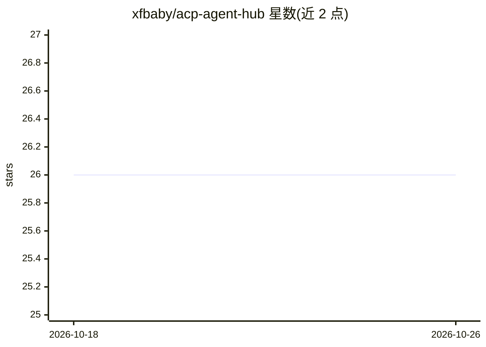

# xfbaby/acp-agent-hub

⭐ 26 · TypeScript · MIT · 推送 2026-05-23 · [GitHub](https://github.com/xfbaby/acp-agent-hub) · 个人维护 · 中文 README

**多平台 ACP 客户端：在 VS Code/CLI/手机上连接 11 种 AI 编程 agent**

Agent Client Protocol (ACP) 的开源多平台实现，为 vscode-acp 的 fork 并包含 Windows 修复。以 JSON-RPC 2.0 (stdio/WebSocket) 统一接入 11 个预配置 AI 编程 agent（GitHub Copilot、Claude Code、Gemini CLI、Qwen Code 等），提供 VS Code 扩展（聊天面板、会话树、文件系统集成、权限管理、协议流量日志）、CLI（Commander.js，REPL 与一次性命令）与移动端 App（经 Node.js WebSocket relay 中继，仅聊天、无文件/终端能力），三平台共享 packages/shared 核心库。需 Node.js 18+，主要从源码构建运行。

## 筛选速览

| 维度 | 判定 | 备注 |
|---|---|---|
| AI 角色 | `ai-ecosystem` | LLM/agent 周边工具 |
| 许可风险 | `permissive` | MIT |
| 部署形态 | `library` | 以包/库形式分发 |
| 模型依赖 | — | README 未给出锁定关系 |
| 硬件要求 | — | 无带数字的原话,不猜 |
| 安装摩擦 | `low` | 无编译、无系统依赖或容器化 |
| 成熟度 | — | 结构信号不足 |

## 能力要点

- 11 个预配置 agent 开箱可用，支持下拉切换、自定义 agent 接入
- VS Code 扩展提供聊天 Webview、会话恢复、权限策略与 JSON-RPC 流量日志
- 移动端经 WebSocket relay 服务器（SQLite 会话持久化）桥接手机与 agent 进程
- 三平台共享同一 ACP 核心库（monorepo，npm workspaces）

## 适用场景

- 在同一个客户端里使用和切换多个 AI 编程 agent，避免工具割裂
- 在手机上通过 relay 服务器远程操作桌面上的 agent
- 在 VS Code 内调试 agent 的 JSON-RPC 协议交互

## 场景标签

 · 领域:开发者工具/AI agent 基础设施

## 证据(README 行号)

> L21: **ACP Client** is an open-source, multi-platform implementation of the Agent Client Protocol (ACP). It acts as an *
> L35: The AI coding tool landscape is fragmented. Each agent has its own UI, its own protocol, its own integration point.
> L42: |Proprietary protocols|Open standard (JSON-RPC 2.0 over stdio/WebSocket)|

## 星数曲线

2026-10-18 26 → 2026-10-26 26（+0）

---
*卡片 v1 · prompt 1.4 · 生成 2026-10-26 · 置信度 high · 依据 README sha `9386846f6f5e` · [字段定义](../../DATASET.md)*
