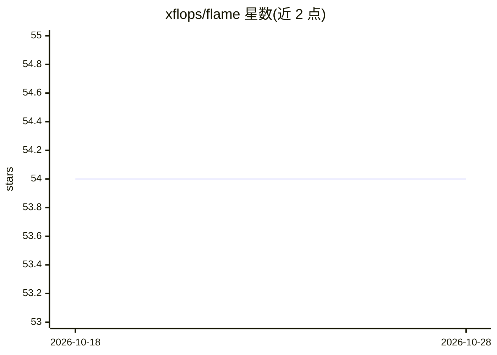

# xflops/flame

⭐ 54 · Rust · Apache-2.0 · 推送 2026-10-27 · [GitHub](https://github.com/xflops/flame) · [官网](https://xflops.io) · 组织维护

**分布式弹性工作负载运行时引擎，支撑 AI Agent、RL、量化计算**

Flame 是面向弹性工作负载（AI Agent、强化学习、量化计算）的分布式引擎，提供 Session/Task/Executor/Shim 四个核心抽象：Session Scheduler 向资源管理器（如 Kubernetes）申请资源启动执行器，执行器通过 gRPC 拉取任务并可跨 Session 复用。执行器运行于 microVM 中以隔离数据泄漏，组件间通信使用 mTLS。提供 Rust/Go/Python 多语言 gRPC 接入，附 flmctl（用户 CLI）与 flmadm（管理员 CLI）两个命令行工具，支持 Docker Compose 本地集群或多节点裸机/VM 部署。

## 筛选速览

| 维度 | 判定 | 备注 |
|---|---|---|
| AI 角色 | `ai-ecosystem` | LLM/agent 周边工具 |
| 许可风险 | `permissive` | Apache-2.0 |
| 部署形态 | `self-host` | docker 或自建部署 |
| 模型依赖 | — | README 未给出锁定关系 |
| 硬件要求 | — | 无带数字的原话,不猜 |
| 安装摩擦 | `low` | 无编译、无系统依赖或容器化 |
| 成熟度 | — | 结构信号不足 |

## 能力要点

- Session/Task/Executor/Shim 核心抽象，执行器跨 Session 复用以减少启动开销
- microVM 运行时隔离与 mTLS 组件间通信
- 通过 gRPC 支持 Rust/Go/Python 多语言接入
- 提供 flmctl 与 flmadm 命令行工具及 Docker Compose 部署方式

## 适用场景

- 大规模运行包含数万短任务的 AI Agent 或强化学习工作负载
- 多租户/多 Session 场景下共享计算资源并做公平调度
- 在 Kubernetes 或裸机集群上部署弹性任务执行引擎

## 场景标签

`强化学习` `金融量化` · 领域:学习与行业

## 证据(README 行号)

> L9: Flame is a distributed engine for elastic workloads, including AI agents, reinforcement learning, and quantitative c
> L13: As AI workloads become increasingly adopted for innovation, a common runtime is essential to accelerate these elast
> L16: * **Performance**: Elastic workloads typically involve tens of thousands of short tasks. Flame leverages cutting-ed

## 星数曲线

2026-10-18 54 → 2026-10-28 54（+0）

---
*卡片 v1 · prompt 1.4 · 生成 2026-10-24 · 置信度 high · 依据 README sha `8d007a127446` · [字段定义](../../DATASET.md)*
