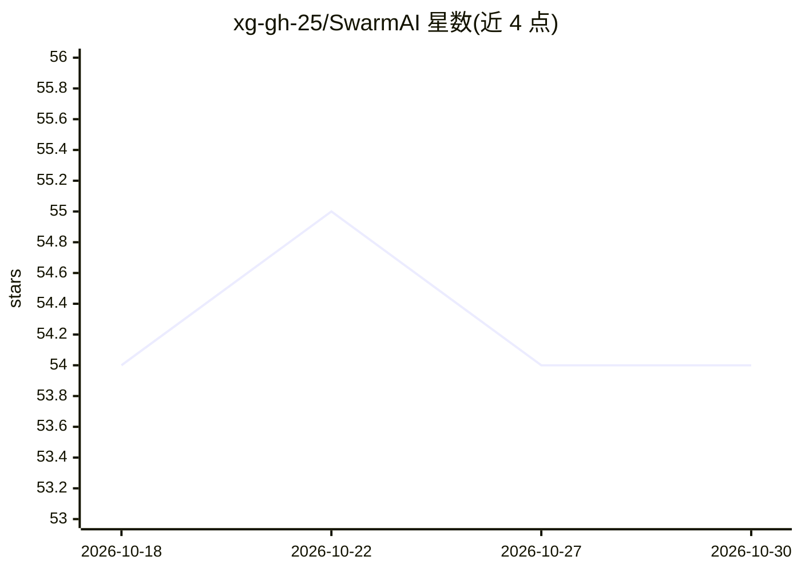

# xg-gh-25/SwarmAI

⭐ 54 · Python · MIT · 推送 2026-10-27 · [GitHub](https://github.com/xg-gh-25/SwarmAI) · [官网](https://github.com/xg-gh-25) · 个人维护 · 中文 README

**自进化的 brain-first Agent OS：认知跨会话持久累积**

SwarmAI 是一个自我进化的 Agent 操作系统，围绕四个理念构建：自我进化（将重复错误转化为代码级 gates，由 security_hooks.py 中的守卫执行）、brain-first（每个项目是一个六段式 domain brain，知识按达尔文式衰减淘汰）、跨会话认知（hooks 在会话之间触发、自我修复、按计划培育与衰减知识）、本体感知（桌面应用读取并驱动自身 UI 状态，TSCC 可检查每轮认知过程）。技术栈为 Tauri 2.0 (Rust)、React 19、FastAPI、Claude Agent SDK + Bedrock、SQLite。需从源码构建运行，macOS Apple Silicon 提供 .dmg 下载；依赖 Node.js 18+、Python 3.11+、Rust、uv、Claude Code CLI。

## 筛选速览

| 维度 | 判定 | 备注 |
|---|---|---|
| AI 角色 | `ai-ecosystem` | LLM/agent 周边工具 |
| 许可风险 | `permissive` | MIT |
| 部署形态 | `desktop` | 安装包/桌面程序 |
| 模型依赖 | — | README 未给出锁定关系 |
| 硬件要求 | — | 无带数字的原话,不猜 |
| 安装摩擦 | `low` | 无编译、无系统依赖或容器化 |
| 成熟度 | — | 结构信号不足 |

## 能力要点

- 将重复错误类转化为 security_hooks.py 中的结构性代码守卫（commit gate、pytest guard 等）
- 每项目为六段式 domain brain，知识无引用即衰减淘汰
- 会话间 hooks 与后台任务，系统自我修复、避免冷启动
- TSCC 展示每轮的文件加载、token 预算、召回命中与完整 prompt

## 适用场景

- 让 agent 在长期项目中积累领域判断并防止同类错误复发
- 运行自主流水线：一个需求直接产出可推送的代码
- 检查与审计 agent 每轮决策背后的上下文与召回过程

## 场景标签

`Agent 框架` `编码 Agent` `Agent 记忆` `LLM 可观测性` · 领域:Agent 开发

## 证据(README 行号)

> L17: **SwarmAI is a self-evolving Agent OS** — every interaction sharpens how the system judges, not just what it knows.
> L105: **Tauri 2.0** (Rust) · **React 19** · **FastAPI** · **Claude Agent SDK + Bedrock** · **SQLite** (WAL + FTS5)

## 星数曲线

2026-10-18 54 → 2026-10-30 54（+0）

---
*卡片 v1 · prompt 1.4 · 生成 2026-10-24 · 置信度 mid · 依据 README sha `adaf66fa8d87` · [字段定义](../../DATASET.md)*
