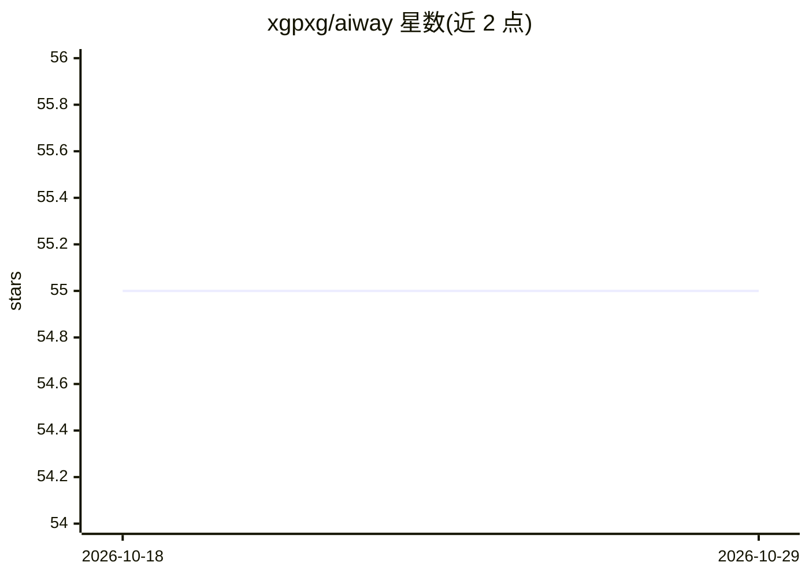

# xgpxg/aiway

⭐ 55 · Rust · Apache-2.0 · 推送 2026-10-13 · [GitHub](https://github.com/xgpxg/aiway) · [官网](https://xgpxg.github.io/aiway/) · 个人维护 · 中文 README

**Rust 编写的 API + AI 融合网关，供开发/运维转发管理请求**

基于 Rust 开发的 API 与 AI 网关，面向需要请求转发与管理的开发/运维场景。支持 HTTP（IPv4/IPv6）、SSE、WebSocket 与 MCP 协议，提供动态路由、插件系统、API Key 管理、日志监控、可视化面板、AI 模型代理与 MCP 集成。节点支持动态扩容/缩容。安装途径包括预编译二进制、源码构建（cargo）与 Docker 镜像，运行于 Linux/macOS 及 openEuler、UOS、KylinOS 等系统。管理控制台默认 7000 端口，网关入口 7001。

## 筛选速览

| 维度 | 判定 | 备注 |
|---|---|---|
| AI 角色 | `ai-ecosystem` | LLM/agent 周边工具 |
| 许可风险 | `permissive` | Apache-2.0 |
| 部署形态 | `self-host` | docker 或自建部署 |
| 模型依赖 | — | README 未给出锁定关系 |
| 硬件要求 | — | 无带数字的原话,不猜 |
| 安装摩擦 | `low` | 无编译、无系统依赖或容器化 |
| 成熟度 | — | 结构信号不足 |

## 能力要点

- 支持 HTTP/SSE/WebSocket/MCP 协议转发
- 动态路由、插件系统、API Key 管理与可视化面板
- AI 模型代理与 MCP 集成
- 提供预编译二进制、源码构建与 Docker 三种部署方式

## 适用场景

- 为后端服务与 AI 模型接口做统一网关转发
- 需要管理 API Key、路由与日志监控的团队
- 在 openEuler/UOS/KylinOS 等国产系统上部署网关

## 场景标签

`模型网关` · 领域:Agent 开发

## 证据(README 行号)

> L9: **aiway** (API and AI Gateway) 是一个基于 Rust 开发的轻量、高性能 API + AI 网关，致力于提供稳定、高效、可扩展的请求转发与管理解决方案。
> L104: - [x] AI 模型代理
> L105: - [x] MCP 集成

## 星数曲线

2026-10-18 55 → 2026-10-29 55（+0）

---
*卡片 v1 · prompt 1.4 · 生成 2026-10-24 · 置信度 high · 依据 README sha `b346b29fedf2` · [字段定义](../../DATASET.md)*
