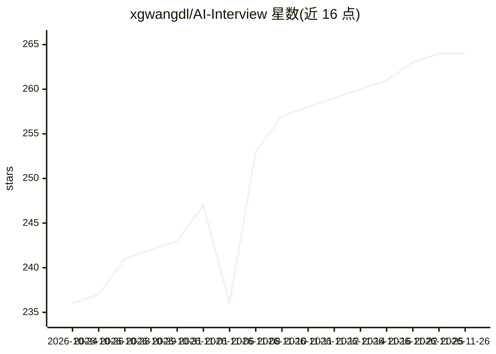

# xgwangdl/AI-Interview

⭐ 264 · Java · Apache-2.0 · 推送 2026-11-20 · [GitHub](https://github.com/xgwangdl/AI-Interview) · 个人维护 · 中文 README

**面向求职开发者的 AI 模拟面试训练系统：录答、追问、逐题评分**

输入目标岗位、JD 与简历后生成面试题目，通过真人形象数字人语音提问并依据回答质量追问，浏览器逐题录制回答并转写，报告按内容相关性、STAR、逻辑、语速等维度评分；低于 75 分的题进入错题本重练，另含 Docker 沙箱判题笔试（Java/Python/C++/JavaScript/Go）与简历解析优化导出。技术栈为 Java 21 + Spring Boot + Spring AI Alibaba + Vue 3 + PostgreSQL/pgvector + Redis，提供本机开发与 docker compose 两种启动方式，无 API Key 时可用 stub 模式体验界面。

## 筛选速览

| 维度 | 判定 | 备注 |
|---|---|---|
| AI 角色 | `ai-native` | 本体是模型或模型工具 |
| 许可风险 | `permissive` | Apache-2.0 |
| 部署形态 | `self-host` | docker 或自建部署 |
| 模型依赖 | — | README 未给出锁定关系 |
| 硬件要求 | — | 无带数字的原话,不猜 |
| 安装摩擦 | `low` | 无编译、无系统依赖或容器化 |
| 成熟度 | — | 结构信号不足 |

## 能力要点

- 数字人面试官语音提问，追问按回答质量决定，每题最多两轮
- AI 出题先在沙箱运行参考解自检，通过才交给用户
- Docker 一次性容器判题：禁网、只读文件系统、限制 CPU/内存/进程数
- 报告维度含 STAR、逻辑、语速、停顿、口头禅，转写可人工校正后单题重评

## 适用场景

- 准备校招、社招、转岗面试，练开口回答并复盘
- 进行带 Docker 判题的上机笔试练习
- 上传简历按 JD 优化并导出 Markdown/Word/PDF
- 组织学习小组作业布置与同伴互评

## 场景标签

`语音合成` `语音识别` `AI 写作` · 领域:内容生成

## 证据(README 行号)

> L7: Light-Interview 是一个开源 AI 面试训练系统：输入目标岗位、JD 和简历，完成一次可录制、可回放、可评分、可重练的模拟面试。
> L73: - 真人形象数字人播报问题，支持提问、聆听、录制、追问等状态；嘴型由音量驱动，不冒充音素级同步。
> L202: |后端|Java 21 · Spring Boot 3.4 · Spring AI 1.1.8 · Spring AI Alibaba|

## 星数曲线

2026-10-24 236 → 2026-11-26 264（+28）

---
*卡片 v1 · prompt 1.4 · 生成 2026-11-25 · 置信度 high · 依据 README sha `47369c07a5c5` · [字段定义](../../DATASET.md)*
