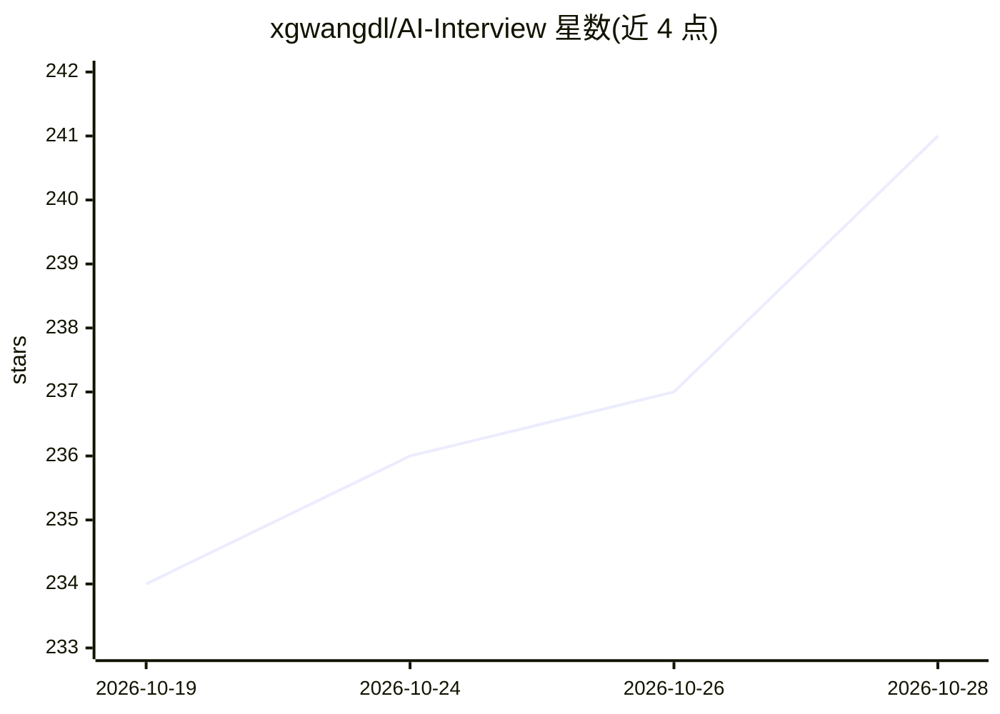

# xgwangdl/AI-Interview

⭐ 241 · Java · Apache-2.0 · 推送 2026-10-27 · [GitHub](https://github.com/xgwangdl/AI-Interview) · 个人维护 · 中文 README

**AI 模拟面试训练系统：数字人面试官逐题提问、追问与评分**

面向求职者的开源 AI 面试训练 Web 应用：输入岗位、JD 与简历后，由 AI 生成并自检题目，真人形象数字人面试官语音提问，浏览器逐题录制回答并转写，报告按相关性、完整度、STAR、语速等维度打分；支持回答 AI 改写、重录对比、错题本与每日训练计划。另含 Docker 隔离沙箱笔试（五种题型、五语言判题）与 AI 简历生成优化。技术栈为 Java 21 + Spring AI Alibaba + Vue 3 + PostgreSQL/pgvector + Redis。口型为音量驱动而非音素同步。

## 筛选速览

| 维度 | 判定 | 备注 |
|---|---|---|
| AI 角色 | `ai-native` | 本体是模型或模型工具 |
| 许可风险 | `permissive` | Apache-2.0 |
| 部署形态 | `self-host` | docker 或自建部署 |
| 模型依赖 | — | README 未给出锁定关系 |
| 硬件要求 | — | 无带数字的原话,不猜 |
| 安装摩擦 | `low` | 无编译、无系统依赖或容器化 |
| 成熟度 | — | 结构信号不足 |

## 能力要点

- AI 按岗位/JD/简历生成题目并先用沙箱自检参考解
- 数字人面试官提问、追问、逐题录制与多维度评分报告
- 一次性 Docker 容器判题：禁网、只读、限 CPU/内存/进程/时间
- 错题本、每日 3 题计划、周报与回答改写重录对比

## 适用场景

- 准备校招/社招/转岗的技术面试，练习开口回答
- 进行限时禁网的编程/SQL 笔试训练
- 复盘录像定位低分回答并对照改写重练
- 按 JD 优化简历并导出 Markdown/Word/PDF

## 场景标签

`语音合成` `语音识别` `AI 写作` · 领域:内容生成

## 证据(README 行号)

> L7: Light-Interview 是一个开源 AI 面试训练系统：输入目标岗位、JD 和简历，完成一次可录制、可回放、可评分、可重练的模拟面试。
> L67: - AI 根据目标岗位、JD 和简历生成题目，支持技术面、行为面、不同难度与面试官风格。

## 星数曲线

2026-10-19 234 → 2026-10-28 241（+7）

---
*卡片 v1 · prompt 1.4 · 生成 2026-10-22 · 置信度 high · 依据 README sha `1c12be03773d` · [字段定义](../../DATASET.md)*
