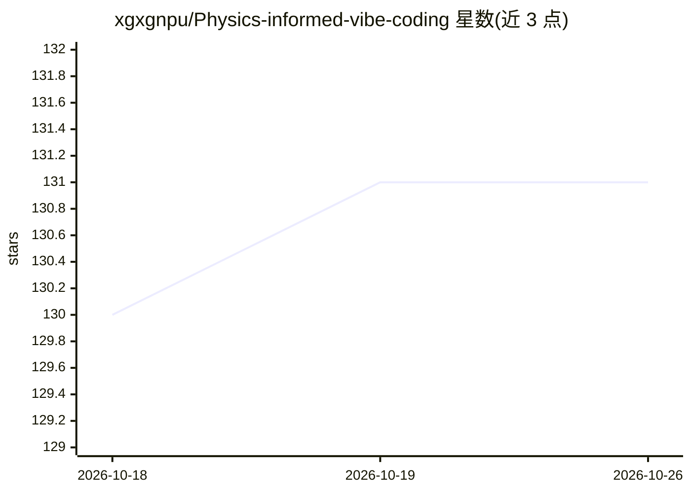

# xgxgnpu/Physics-informed-vibe-coding

⭐ 131 · Python · 推送 2026-09-23 · [GitHub](https://github.com/xgxgnpu/Physics-informed-vibe-coding) · 组织维护 · 中文 README

**科学机器学习算法的 JAX-GPU 代码集合（PINNs/PIELM/RFM/神经算子）**

由西北工业大学研究者维护的科学机器学习代码仓库，提供 PINNs、PIELM、随机特征方法、神经算子等算法的自包含 JAX-GPU 实现，每个案例为单个 .py 文件，运行后自动保存数据、图像与模型检查点，并配套中文学术教程。特色是采用 Vibe Coding 工作流：人类提出与验证科学问题，AI 智能体负责代码编写、实验运行与调优。README 同时包含付费课程宣传与社群入口。依赖 jax/jaxlib(CUDA)/optax 等。

## 筛选速览

| 维度 | 判定 | 备注 |
|---|---|---|
| AI 角色 | `ai-ecosystem` | LLM/agent 周边工具 |
| 许可风险 | `permissive` | — |
| 部署形态 | `None` |  |
| 模型依赖 | — | README 未给出锁定关系 |
| 硬件要求 | — | 无带数字的原话,不猜 |
| 安装摩擦 | `medium` | 含编译或系统依赖之一 |
| 成熟度 | `idea` | |

## 能力要点

- PINNs、PIELM、随机特征方法、神经算子的 JAX-GPU 实现
- 每个案例为自包含单文件脚本，结果自动保存（txt/png/pkl）
- 人类提出问题、AI 智能体写码与实验的 Vibe Coding 工作流
- 配套中文学术教程

## 适用场景

- 运行与复现 PINN/神经算子等科学机器学习案例
- 学习科学机器学习算法的 JAX 实现与底层数理
- 参考人机协作的科研代码工作流

## 场景标签

`教程课程` · 领域:学习与行业

## 证据(README 行号)

> L3: **首个采用 Vibe Coding 理念进行科学机器学习（PINNs · PIELM · 随机特征方法 · 神经算子）研究的开源仓库**
> L43: > **Vibe Coding & Vibe Researching** — 人类负责发现并提出重要科学问题，AI 智能体负责编程、执行实验与自动优化计算过程，最终由人类核对、验证并验收结果。全程不手写一行代码，（尝试）完成完整的
> L51: `jax`, `jaxlib` (CUDA), `optax`, `matplotlib`, `numpy`, `scipy`

## 星数曲线

2026-10-18 130 → 2026-10-26 131（+1）

---
*卡片 v1 · prompt 1.4 · 生成 2026-10-23 · 置信度 mid · 依据 README sha `c37fd1fb22b3` · [字段定义](../../DATASET.md)*
