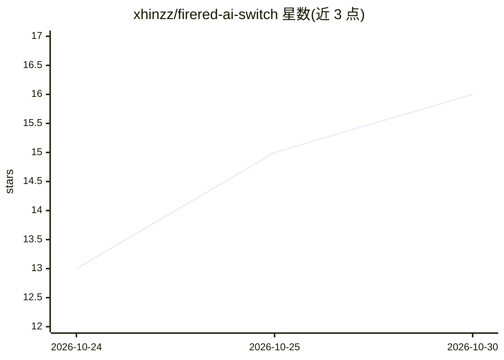

# xhinzz/firered-ai-switch

⭐ 16 · Python · MIT · 推送 2026-10-23 · [GitHub](https://github.com/xhinzz/firered-ai-switch) · [官网](https://xhinzz.github.io/firered-ai-switch/) · 个人维护

**在真实 Switch 硬件上自动游玩宝可梦火红的视觉 AI agent**

通过 HDMI 采集卡读取 Switch 画面，经模拟蓝牙 Pro Controller 输出按键，全程不使用模拟器、ROM 或游戏内存。感知层用画面分类、309 张地图定位与游戏字体 OCR 读屏；世界知识来自 pret/pokefirered 反编译数据（setup 时下载）；LLM 分为制定计划的 strategist 与带约 60 个工具执行计划的 executor，行走、战斗、捕捉等确定性操作由脚本技能完成；另含 ACE 工具包与赛后任务脚本。需要 Windows、Switch、采集卡、蓝牙适配器与 LLM key；代码注释为葡萄牙语。

## 筛选速览

| 维度 | 判定 | 备注 |
|---|---|---|
| AI 角色 | `ai-native` | 本体是模型或模型工具 |
| 许可风险 | `permissive` | MIT |
| 部署形态 | `None` |  |
| 模型依赖 | locked-api |  |
| 硬件要求 | — | 无带数字的原话,不猜 |
| 安装摩擦 | `low` | 无编译、无系统依赖或容器化 |
| 成熟度 | — | 结构信号不足 |

## 能力要点

- 像素输入、蓝牙手柄输出，不读游戏内存不用模拟器
- LLM（strategist+executor 双角色约 60 工具）+ 确定性技能分层
- 基于 pret 反编译数据的 309 张地图运行时定位
- ACE 工具包与赛后脚本任务（闪光神兽捕捉）

## 适用场景

- 让 AI 在真实主机上通关宝可梦火红
- 研究视觉输入+LLM 规划的游戏 agent 架构
- 复用其读屏定位与路径规划组件做类似项目

## 场景标签

 · 领域:游戏 AI/机器人

## 证据(README 行号)

> L29: - **LLM where judgement matters, code where speed matters.** A strategist model plans, an executor model plays the
> L57: |Agent|`fireredia.agente`|LLM episodes in two roles: the **strategist** reads the memory and writes a plan, the **e

## 星数曲线

2026-10-24 13 → 2026-10-30 16（+3）

---
*卡片 v1 · prompt 1.4 · 生成 2026-10-30 · 置信度 high · 依据 README sha `e42f1721673a` · [字段定义](../../DATASET.md)*
