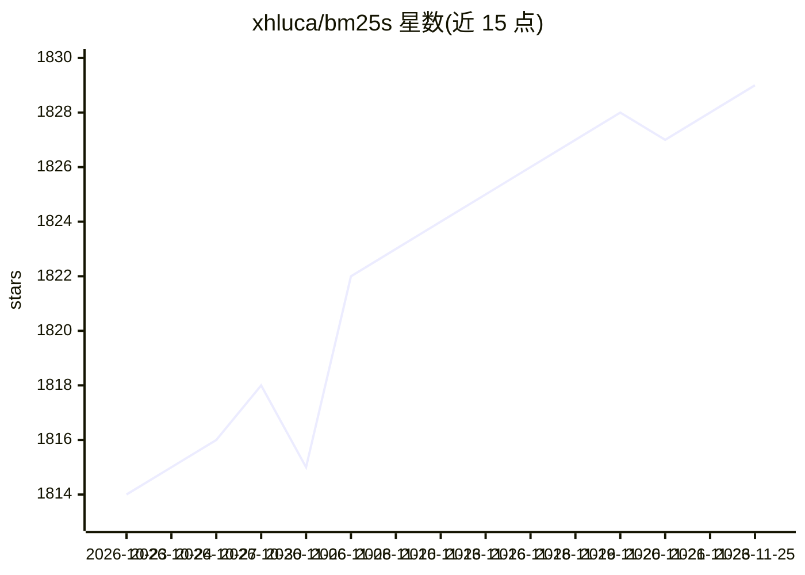

# xhluca/bm25s

⭐ 1,829 · Python · MIT · 推送 2026-11-13 · [GitHub](https://github.com/xhluca/bm25s) · [官网](https://bm25s.github.io) · 个人维护

**Python BM25 稀疏检索库：为文本查询排序文档**

基于 Numpy 稀疏矩阵预计算评分的 BM25 实现，支持 Robertson、ATIRE、BM25L、BM25+、Lucene 五种变体，提供 Python API、命令行 CLI 与内置 MCP 服务器（可将索引暴露为 LLM agent 工具，附 Claude Desktop 配置示例）。支持 mmap 内存映射加载大索引、自定义分词器与词干提取，可配合可选的 numba 后端加速，并通过 huggingface_hub 保存/加载索引到模型中心。以 pip 包发布，无需 Java 或 PyTorch。

## 筛选速览

| 维度 | 判定 | 备注 |
|---|---|---|
| AI 角色 | `ai-native` | 本体是模型或模型工具 |
| 许可风险 | `permissive` | MIT |
| 部署形态 | `library` | 以包/库形式分发 |
| 模型依赖 | — | README 未给出锁定关系 |
| 硬件要求 | — | 无带数字的原话,不猜 |
| 安装摩擦 | `low` | 无编译、无系统依赖或容器化 |
| 成熟度 | — | 结构信号不足 |

## 能力要点

- 纯 Python + Numpy 稀疏矩阵实现，预计算评分实现快速查询
- 内置 MCP 服务器，可把 BM25 索引作为 LLM agent 工具暴露
- 支持 5 种 BM25 变体与自定义 Tokenizer、词干提取
- mmap 内存映射加载索引，支持 Hugging Face Hub 存取

## 适用场景

- 为 RAG 流程提供快速词法检索与文档排序
- 用 CLI 对本地 CSV/JSONL 文件建索引并搜索
- 通过 MCP server 让 Claude 等 agent 调用本地检索工具
- 将 BM25 索引分享到 Hugging Face Hub

## 场景标签

 · 领域:信息检索/文本检索

## 证据(README 行号)

> L21: Welcome to `bm25s`, a library that implements BM25 in Python, allowing you to rank documents based on a query. BM25
> L325: `bm25s` comes with a built-in Model Context Protocol (MCP) server, allowing you to expose your BM25 index as a too

## 星数曲线

2026-10-23 1,814 → 2026-11-25 1,829（+15）

---
*卡片 v1 · prompt 1.4 · 生成 2026-11-23 · 置信度 high · 依据 README sha `36eb5737f634` · [字段定义](../../DATASET.md)*
