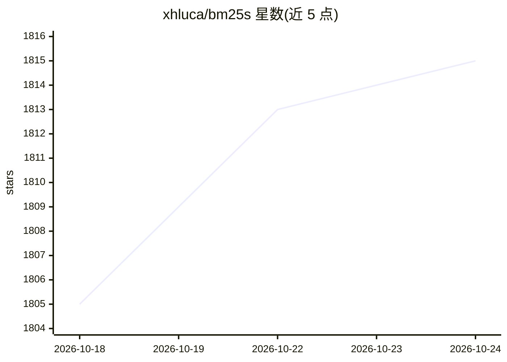

# xhluca/bm25s

⭐ 1,815 · Python · MIT · 推送 2026-10-22 · [GitHub](https://github.com/xhluca/bm25s) · [官网](https://bm25s.github.io) · 个人维护

**纯 Python 实现的 BM25 词法检索库，供开发者做文档排序与 RAG 检索**

基于 Numpy 与稀疏矩阵实现的 BM25 词法检索库：预计算所有文档 token 的分数并以稀疏矩阵存储，查询时直接打分；依赖仅需 Numpy，可选 numba 后端加速与 PyStemmer 词干化。提供 Python API、高层接口、命令行 CLI（索引/搜索/用户目录）、mmap 内存映射加载、Hugging Face Hub 索引存取，以及内置 MCP Server 可将索引暴露为 LLM/agent 工具。支持 robertson/atire/BM25L/BM25+/Lucene 五种变体，默认 Lucene。面向需要轻量级无 Java/PyTorch 依赖检索方案的开发者。

## 筛选速览

| 维度 | 判定 | 备注 |
|---|---|---|
| AI 角色 | `ai-ecosystem` | LLM/agent 周边工具 |
| 许可风险 | `permissive` | MIT |
| 部署形态 | `library` | 以包/库形式分发 |
| 模型依赖 | — | README 未给出锁定关系 |
| 硬件要求 | — | 无带数字的原话,不猜 |
| 安装摩擦 | `low` | 无编译、无系统依赖或容器化 |
| 成熟度 | — | 结构信号不足 |

## 能力要点

- 稀疏矩阵预计算分数的 BM25 实现，仅需 Numpy，可选 numba 后端（约 2x 加速）
- 提供 CLI（index/search）与 ~/.bm25s 用户目录、交互式索引选择器
- 支持 mmap 内存映射加载大索引与 Hugging Face Hub 索引存取
- 内置 MCP Server，可将 BM25 索引作为 retrieve 工具暴露给 LLM/agent

## 适用场景

- 为 RAG 流水线提供轻量的词法检索组件
- 在本地对 CSV/JSON/JSONL/TXT 文件建立索引并命令行搜索
- 通过 MCP 将 BM25 检索暴露给 Claude Desktop 等 LLM 客户端

## 场景标签

 · 领域:信息检索/RAG 基础组件

## 证据(README 行号)

> L21: Welcome to `bm25s`, a library that implements BM25 in Python, allowing you to rank documents based on a query. BM25
> L24: * **Fast**: `bm25s` is implemented in pure Python and leverage sparse matrices to store eagerly computed scores for
> L302: `bm25s` comes with a built-in Model Context Protocol (MCP) server, allowing you to expose your BM25 index as a too

## 星数曲线

2026-10-18 1,805 → 2026-10-24 1,815（+10）

---
*卡片 v1 · prompt 1.4 · 生成 2026-10-21 · 置信度 high · 依据 README sha `baa08115770e` · [字段定义](../../DATASET.md)*
