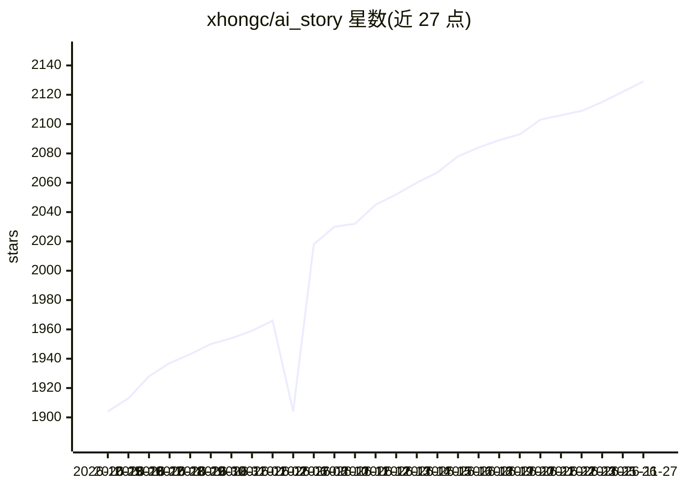

# xhongc/ai_story

⭐ 2,129 · Python · 推送 2026-11-26 · [GitHub](https://github.com/xhongc/ai_story) · 个人维护 · 中文 README

**面向创作者的文案到视频一键自动化生成平台**

AI Story 是一个故事视频自动化生成平台，用户输入主题后系统按流水线完成文案改写、分镜生成、图片生成、运镜规划、图片转视频、项目导出全流程，各阶段支持暂停、恢复、重试与手动调整。内置提示词管理与模型配置模块，支持多服务商、负载均衡与成本统计。技术栈含 Celery 异步队列与 Redis，通过 Docker Compose 一键启动，许可证为 CC BY-NC-SA 4.0（非商业）。

## 筛选速览

| 维度 | 判定 | 备注 |
|---|---|---|
| AI 角色 | `ai-native` | 本体是模型或模型工具 |
| 许可风险 | `none` | — |
| 部署形态 | `self-host` | docker 或自建部署 |
| 模型依赖 | — | README 未给出锁定关系 |
| 硬件要求 | — | 无带数字的原话,不猜 |
| 安装摩擦 | `low` | 无编译、无系统依赖或容器化 |
| 成熟度 | — | 结构信号不足 |

## 能力要点

- 文案→分镜→图片→运镜→视频的全流程自动化流水线
- 统一模型配置：多服务商、负载均衡、使用量统计
- 项目管理支持阶段回滚、模板保存与导出（视频合成、字幕）
- Docker Compose 一键部署

## 适用场景

- 为抖音、快手等平台批量生成故事短视频
- 把文字科普内容转成可视化视频
- 把儿童故事制作成动画视频
- 快速制作视频脚本原型与分镜预览

## 场景标签

`AI 写作` `图像生成` `视频生成` · 领域:内容生成

## 证据(README 行号)

> L14: AI Story 是一个基于人工智能的故事视频自动化生成平台。只需输入一个故事主题,系统就能自动完成文案创作、分镜设计、图片生成、运镜规划和视频制作的全流程,让视频创作变得简单高效。
> L160: 输入主题 → 文案改写 → 分镜生成 → 图片生成 → 运镜规划 → 视频生成 → 完成

## 星数曲线

2026-10-25 1,904 → 2026-11-27 2,129（+225）

---
*卡片 v1 · prompt 1.4 · 生成 2026-11-27 · 置信度 high · 依据 README sha `649d6c61b7a8` · [字段定义](../../DATASET.md)*
