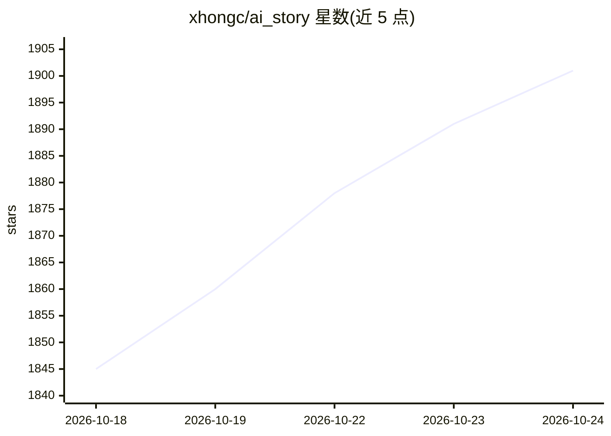

# xhongc/ai_story

⭐ 1,901 · Python · 推送 2026-10-13 · [GitHub](https://github.com/xhongc/ai_story) · 个人维护 · 中文 README

**输入故事主题自动生成视频的平台：文案→分镜→图片→成片**

基于 AI 的故事视频自动化生成平台：用户输入故事主题或大纲，系统按 Pipeline 流程依次完成文案改写、分镜生成、AI 图片生成、运镜规划与图片转视频，支持各阶段暂停、恢复、重试与手动调整。支持多种 AI 服务商配置（OpenAI、Claude 等），每阶段可配多模型并做负载均衡调度；图片生成支持 Stable Diffusion/DALL-E 等平台，视频生成支持 Runway、Pika 等。通过 Docker Compose 部署，采用 CC BY-NC-SA 4.0 许可证；导演模式标注为正在开发中。

## 筛选速览

| 维度 | 判定 | 备注 |
|---|---|---|
| AI 角色 | `ai-native` | 本体是模型或模型工具 |
| 许可风险 | `none` | — |
| 部署形态 | `self-host` | docker 或自建部署 |
| 模型依赖 | — | README 未给出锁定关系 |
| 硬件要求 | — | 无带数字的原话,不猜 |
| 安装摩擦 | `low` | 无编译、无系统依赖或容器化 |
| 成熟度 | — | 结构信号不足 |

## 能力要点

- 主题输入到成片的全流程自动化 Pipeline（文案/分镜/图片/运镜/视频）
- 每阶段可配置多个 AI 服务商，支持轮询/随机/权重/最少负载调度
- 项目全生命周期管理：暂停、恢复、回滚、模板复用
- Docker Compose 一键启动，Celery 异步任务队列处理

## 适用场景

- 快速生成抖音、快手等平台的故事短视频
- 把童话故事转化为儿童动画视频
- 文字科普内容可视化为视频
- 制作视频脚本原型和分镜预览

## 场景标签

`视频生成` · 领域:内容生成

## 证据(README 行号)

> L14: AI Story 是一个基于人工智能的故事视频自动化生成平台。只需输入一个故事主题,系统就能自动完成文案创作、分镜设计、图片生成、运镜规划和视频制作的全流程,让视频创作变得简单高效。
> L156: 输入主题 → 文案改写 → 分镜生成 → 图片生成 → 运镜规划 → 视频生成 → 完成

## 星数曲线

2026-10-18 1,845 → 2026-10-24 1,901（+56）

---
*卡片 v1 · prompt 1.4 · 生成 2026-10-21 · 置信度 high · 依据 README sha `1d8368035e8f` · [字段定义](../../DATASET.md)*
