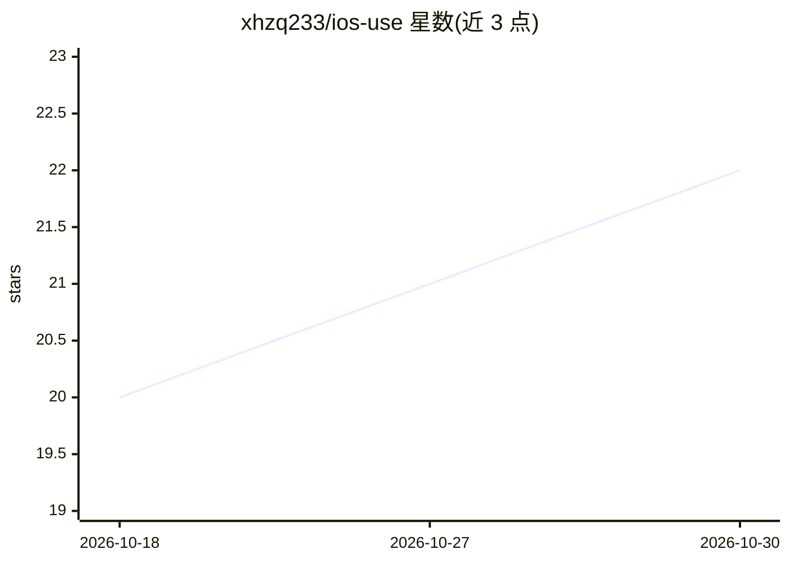

# xhzq233/ios-use

⭐ 22 · Swift · AGPL-3.0 · 推送 2026-10-28 · [GitHub](https://github.com/xhzq233/ios-use) · 个人维护

**终端控制 iPhone/Mac 应用的 iOS UI 自动化 CLI，可由 AI 驱动**

基于轻量 XCTest TCP 驱动的 iOS UI 自动化工具：驱动真机、模拟器及 Apple silicon Mac 上的 iPhone 应用，暴露可访问性树、语义动作、JSON 输出、截图、日志、代理抓包与多设备操作。真机无需 Xcode，支持免费 Apple Developer 签名（七天续签）。Mac 后端经 Catalyst 运行 iPhone 应用，内置 Frida 调试，提供设备预设与旋转。Linux 主机可远程操作 iOS 驱动，但 OCR、USB、模拟器等功能需 macOS。可通过 shell 脚本一条命令安装，并附带 agent skill 供 AI 调用。

## 筛选速览

| 维度 | 判定 | 备注 |
|---|---|---|
| AI 角色 | `ai-ecosystem` | LLM/agent 周边工具 |
| 许可风险 | `viral` | AGPL-3.0 |
| 部署形态 | `None` |  |
| 模型依赖 | — | README 未给出锁定关系 |
| 硬件要求 | — | 无带数字的原话,不猜 |
| 安装摩擦 | `low` | 无编译、无系统依赖或容器化 |
| 成熟度 | — | 结构信号不足 |

## 能力要点

- 真机自动化无需 Xcode，支持免费 Apple Developer 签名
- 暴露可访问性树、语义动作、JSON 输出与多设备操作
- Mac 后端经 Catalyst 运行 iPhone App，内置 Frida 调试
- 附带 agent skill（~/.agents/skills/ios-use）供 AI 客户端调用

## 适用场景

- 用 CLI 脚本自动化测试或操作 iPhone 应用
- 让 AI agent 通过 skill 控制真实 iOS 设备
- 在 Mac 上以设备预设预览与调试 iPhone App 布局

## 场景标签

`GUI 自动化` · 领域:效率与自动化

## 证据(README 行号)

> L3:  Control iPhone apps with AI or a few lines of code.
> L23: `ios-use` drives real iPhones, Simulators, and supported iPhone Apps on Apple
> L24: silicon Macs. It exposes a compact accessibility tree, semantic actions, JSON

## 星数曲线

2026-10-18 20 → 2026-10-30 22（+2）

---
*卡片 v1 · prompt 1.4 · 生成 2026-10-28 · 置信度 high · 依据 README sha `b7a8625ad631` · [字段定义](../../DATASET.md)*
