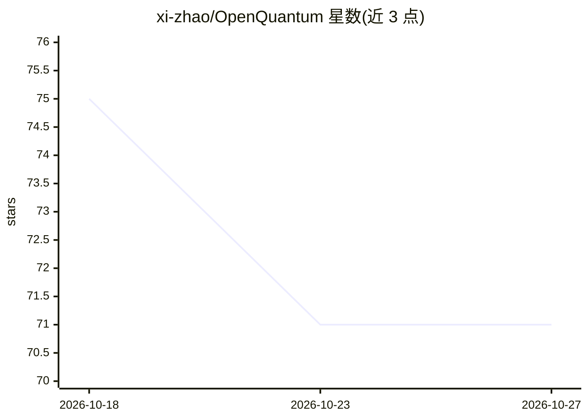

# xi-zhao/OpenQuantum

⭐ 71 · JavaScript · MIT · 推送 2026-10-26 · [GitHub](https://github.com/xi-zhao/OpenQuantum) · [官网](https://xi-zhao.github.io/OpenQuantum/) · 个人维护 · 中文 README

**面向量子科研的开源 AI Agent 平台：桌面端+Codex 插件**

开源量子科研 AI 平台，提供 Desktop 客户端（复用 DSH Desktop 原版界面并单独交付量子能力包）、Codex 插件与消息渠道入口。AI Agent 按任务使用 Skill 中的方法并调用 Tool 执行量子计算：覆盖算法学习、电路与量子信息、量子化学、量子纠错、哈密顿量模拟、光子计算等方向，接入 Qiskit、PennyLane、QuTiP 等 111 个 SDK/源码环境，并保留程序、结果与核对记录。模型服务可自行配置；部分 SDK 环境标注为未经验收（not_evaluated），教学应用的在线 AI 功能仍待完整验收。

## 筛选速览

| 维度 | 判定 | 备注 |
|---|---|---|
| AI 角色 | `ai-native` | 本体是模型或模型工具 |
| 许可风险 | `permissive` | MIT |
| 部署形态 | `desktop` | 安装包/桌面程序 |
| 模型依赖 | — | README 未给出锁定关系 |
| 硬件要求 | — | 无带数字的原话,不猜 |
| 安装摩擦 | `low` | 无编译、无系统依赖或容器化 |
| 成熟度 | `idea` | |

## 能力要点

- 168 个 Skill、87 个科学 Tool，111 个 SDK/源码环境提供原生 API 使用路径
- 覆盖算法、电路、化学、纠错、模拟、光子与量子网络等方向的计算任务
- PennyLane/QuTiP 优化实测案例保留性能对照、结果核对与复跑记录
- 支持 Codex 插件、桌面客户端、微信/飞书/Telegram 等消息渠道发起任务

## 适用场景

- 围绕量子研究问题让 AI 选择方法、执行计算并核对结果
- 从可运行算法示例入手学习并比较量子方法
- 在应用中通过 Skill、Tool 与原生 SDK 接入量子计算能力
- 借助量子学习通组织教学材料与课程

## 场景标签

`科研工具` `教程课程` · 领域:学习与行业

## 证据(README 行号)

> L12: OpenQuantum 是开源开放的量子科研 AI 平台，连接开源社区的优秀软件、算法与公开研究成果，让 AI 围绕你的研究问题开展分析、选择方法、执行计算并核对结果，把专业积累转化为实际的科研能力。
> L86: Agent 可以帮你阅读材料、编写程序和调用工具。安装 OpenQuantum 后，你可以围绕已支持的任务，按需要准备依赖和服务配置，让 AI 用上量子领域的方法与计算能力。Skill 说明方法与步骤，Tool 执行具体动作，原生
> L130: 选择一个方向，告诉工作台你的问题、输入和希望检查的结果。OpenQuantum 的 Agent 按任务使用 Skill 中的方法，并调用相应 Tool 执行计算；量子学习通提供独立的教学界面。

## 星数曲线

2026-10-18 75 → 2026-10-27 71（-4）

---
*卡片 v1 · prompt 1.4 · 生成 2026-10-24 · 置信度 low · 依据 README sha `63f12c781c58` · [字段定义](../../DATASET.md)*
