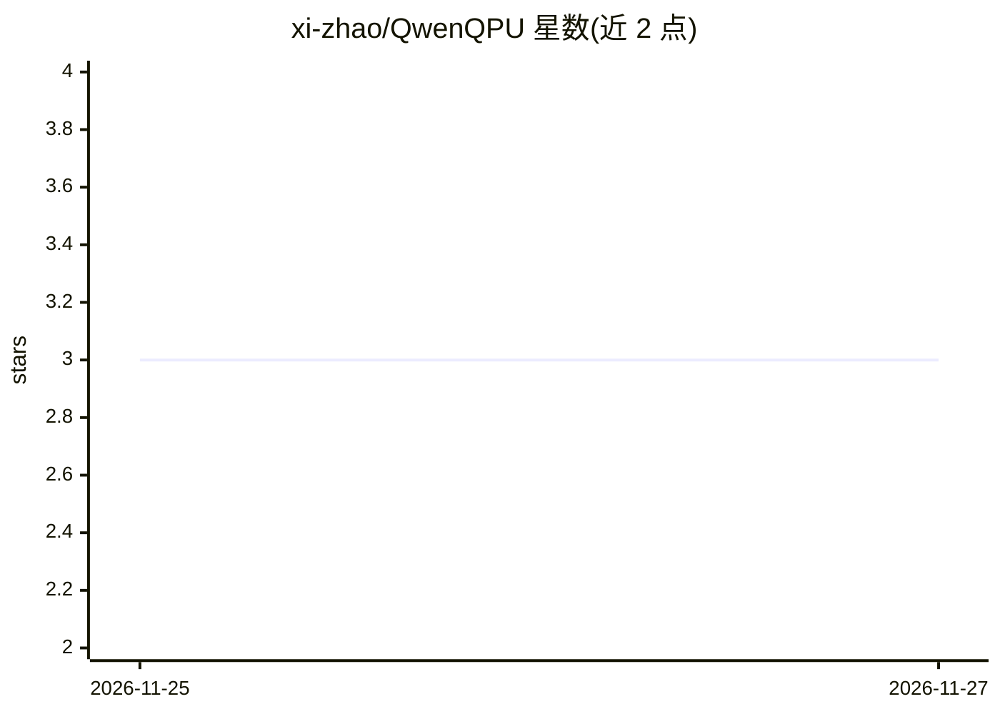

# xi-zhao/QwenQPU

⭐ 3 · Python · 推送 2026-11-08 · [GitHub](https://github.com/xi-zhao/QwenQPU) · 个人维护 · 中文 README

**在 Qwen3.5-4B 内置固定权重 QPU 层以精确模拟量子电路**

在标准 Qwen3.5 检查点之上添加四个由编译器解析设定权重的层，用 Gated DeltaNet 记忆保存量子态向量，在前向传播中执行 H/X/T/CNOT 通用门集：模型读取任务、提交电路，新增层返回测量概率。语言模型与 QPU 共享同一 Transformers 前向流程，宿主仅作 I/O 总线，自身不计算幅值或概率。构造器无需训练或下载即可写出 1.42 GB 权重；全模型保持 FP32，峰值占用 38.4 GB。范围限于最多六量子比特的精确态矢量模拟，内存随量子比特数按 2ⁿ 增长。

## 筛选速览

| 维度 | 判定 | 备注 |
|---|---|---|
| AI 角色 | `ai-native` | 本体是模型或模型工具 |
| 许可风险 | `none` | — |
| 部署形态 | `None` |  |
| 模型依赖 | — | README 未给出锁定关系 |
| 硬件要求 | — | 无带数字的原话,不猜 |
| 安装摩擦 | `low` | 无编译、无系统依赖或容器化 |
| 成熟度 | — | 结构信号不足 |

## 能力要点

- 四层固定权重层在前向传播中执行通用 H/X/T/CNOT 门集
- 48 项三至六量子比特电路基准任务全部通过（对比基座 4/48）
- 无训练、无下载的编译式权重构造器（1.42 GB）
- 精度以 Qiskit 独立值校验，容差 5e-5

## 适用场景

- 让语言模型对提交的量子电路给出精确测量概率
- 复现固定权重编译层方法的基准实验
- 研究在 Transformer 权重中执行数值计算的方式

## 场景标签

`科研工具` `模型评测` · 领域:评测与运维

## 证据(README 行号)

> L10: submits the circuit; the added layers return the measurement probabilities.
> L68: **Scope.** QwenQPU performs exact classical state-vector simulation of supplied

## 星数曲线

2026-11-25 3 → 2026-11-27 3（+0）

---
*卡片 v1 · prompt 1.4 · 生成 2026-11-24 · 置信度 high · 依据 README sha `371907ff8fb2` · [字段定义](../../DATASET.md)*
