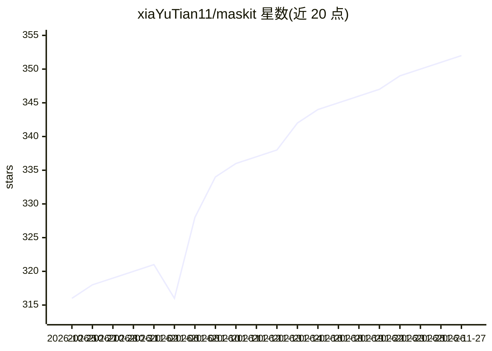

# xiaYuTian11/maskit

⭐ 352 · Python · AGPL-3.0 · 推送 2026-11-26 · [GitHub](https://github.com/xiaYuTian11/maskit) · 个人维护 · 中文 README

**给 AI 编程工具加本地脱敏网关：请求打码、回复流式还原**

部署在本地终端与云端大模型之间的代理网关：请求发出前将 21 类内置规则命中的敏感信息替换为确定性占位符，图片按字符级物理涂黑，模型回复中的占位符经 SSE 流式切片增量还原为原文。接入方式是将工具的 API Base URL 指向本地端口（OpenAI/DeepSeek/Anthropic 三种协议分端口），支持 Windows/macOS/Linux 安装包、Docker 与浏览器扩展联动，含 ONNX 离线 NER 识别、文件脱敏工作台、危险命令告警与多级日志隐私模式，全程本地运算、零遥测。

## 筛选速览

| 维度 | 判定 | 备注 |
|---|---|---|
| AI 角色 | `ai-ecosystem` | LLM/agent 周边工具 |
| 许可风险 | `viral` | AGPL-3.0 |
| 部署形态 | `desktop` | 安装包/桌面程序 |
| 模型依赖 | — | README 未给出锁定关系 |
| 硬件要求 | — | 无带数字的原话,不猜 |
| 安装摩擦 | `low` | 无编译、无系统依赖或容器化 |
| 成熟度 | — | 结构信号不足 |

## 能力要点

- 出站请求本地打码为占位符，回复 SSE 流式无感还原
- 21 类内置脱敏规则与自定义敏感词/正则，多轮会话占位符映射一致
- 图片/PDF/Word 的 OCR 字符级物理打码，含本地 RapidOCR+ONNX Runtime 可选引擎
- 三种协议本地端口接入，任意可配 Base URL 的 CLI/SDK 均可用

## 适用场景

- 用 Cursor/Claude Code 写代码时防止密钥与内网连接串上传
- 在 ChatGPT 网页版粘贴文档前自动脱敏手机号身份证
- 团队/NAS 上以 Docker 跑私有脱敏网关统一管控

## 场景标签

`网络安全` · 领域:学习与行业

## 证据(README 行号)

> L23: **Maskit 的使命**：在你的开发终端与大模型之间架设一道透明的本地网关 —— **出网前在本地打码成结构化占位符（图片则物理涂黑），模型回答时毫秒级流式无感还原为原文！**
> L117: 只需将你工具中的 **API Base URL** 指向 Maskit 对应的本地端口即可！

## 星数曲线

2026-10-25 316 → 2026-11-27 352（+36）

---
*卡片 v1 · prompt 1.4 · 生成 2026-11-27 · 置信度 high · 依据 README sha `147cf3a1e691` · [字段定义](../../DATASET.md)*
