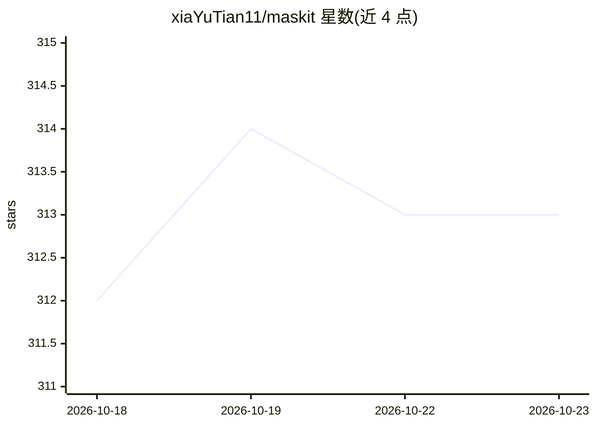

# xiaYuTian11/maskit

⭐ 313 · Python · AGPL-3.0 · 推送 2026-10-21 · [GitHub](https://github.com/xiaYuTian11/maskit) · 个人维护 · 中文 README

**本地隐私脱敏网关：大模型请求自动打码、回复流式还原**

架设在开发终端与外部大模型服务之间的本地反向代理网关：请求出网前将密钥、连接串、PII 等敏感信息替换为结构化占位符，模型回复在本地毫秒级流式还原；多轮会话中占位符保持一致。内置 21 类正则规则与可选本地 ONNX NER 模型（默认关闭）。通过改 Base URL 接入 Cursor/Claude Code/Codex 等任意工具，另有 Chrome/Edge 扩展覆盖网页版 AI。提供 Windows/macOS 安装包、Docker 镜像与源码运行三种部署方式；脱敏计算全在本机 CPU，多并发场景下 NER 是主要消耗。

## 筛选速览

| 维度 | 判定 | 备注 |
|---|---|---|
| AI 角色 | `ai-ecosystem` | LLM/agent 周边工具 |
| 许可风险 | `viral` | AGPL-3.0 |
| 部署形态 | `desktop` | 安装包/桌面程序 |
| 模型依赖 | locked-api |  |
| 硬件要求 | — | 无带数字的原话,不猜 |
| 安装摩擦 | `low` | 无编译、无系统依赖或容器化 |
| 成熟度 | — | 结构信号不足 |

## 能力要点

- 21 类脱敏规则库 + 可选本地 ONNX NER 实体识别（默认关闭）
- 多轮会话占位符滑动窗口复用，保持映射一致
- 免装根证书的多端口反代模式 + 兜底透明直连，代理停止不断网
- Chrome/Edge MV3 扩展覆盖 ChatGPT/Claude/DeepSeek 等 17 个网页版 AI 站点

## 适用场景

- 在 Cursor / Claude Code 等编程助手中防止密钥、连接串、手机号出网
- 团队在服务器/NAS 上以 Docker 部署统一的脱敏私有网关
- 网页版 ChatGPT/Claude 上传 Office 文档前自动打码（已适配站点）
- 审计大模型请求链路的脱敏明细与 Token 成本

## 场景标签

 · 领域:AI 安全/隐私基础设施

## 证据(README 行号)

> L27: **Maskit 的使命**：在你的开发终端与外部 AI 服务之间架设一道透明的“本地隐私防护网关”——**请求出网前在本地自动打码成结构化占位符，模型回答时毫秒级流式无感还原成原文**！
> L95: 接入极简：**在你的任意工具中，只需把 API Base URL 改为 Maskit 对应的本地端口即可**！
> L68: - **多端口反代模式**：为不同模型/渠道分配独立本地端口（如 `18701` 对应 OpenAI、`18703` 对应 Anthropic），只需在工具中将 `base_url` 改为本地端口，**无需向操作系统安装自签名 C

## 星数曲线

2026-10-18 312 → 2026-10-23 313（+1）

---
*卡片 v1 · prompt 1.4 · 生成 2026-10-21 · 置信度 mid · 依据 README sha `636270a8ec7f` · [字段定义](../../DATASET.md)*
