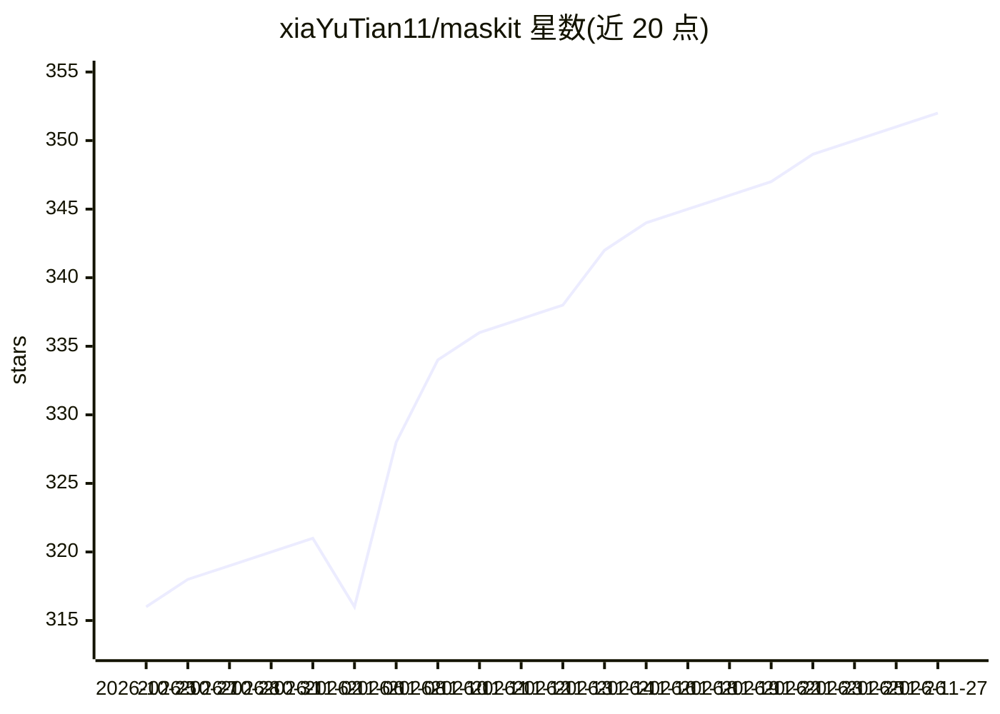

# xiaYuTian11/maskit

⭐ 352 · Python · AGPL-3.0 · 推送 2026-11-26 · [GitHub](https://github.com/xiaYuTian11/maskit) · 个人维护 · 中文 README

**给 AI 编程工具加本地脱敏网关：请求打码、回复还原**

本地运行的隐私脱敏代理：将 Cursor、Claude Code、Codex 等工具的 API Base URL 指向本地端口，请求出网前把密钥、连接串、PII 等替换为确定性占位符，回复流式增量还原原文；图片类敏感内容物理涂黑且不可逆。内置 21 类正则规则与离线 ONNX 语义识别（NER），支持多轮会话占位符一致复用。提供 Windows/macOS/Linux 安装包、Docker 镜像与浏览器扩展，AGPL-3.0 协议，声明零遥测、纯本地运算。

## 筛选速览

| 维度 | 判定 | 备注 |
|---|---|---|
| AI 角色 | `ai-ecosystem` | LLM/agent 周边工具 |
| 许可风险 | `viral` | AGPL-3.0 |
| 部署形态 | `desktop` | 安装包/桌面程序 |
| 模型依赖 | — | README 未给出锁定关系 |
| 硬件要求 | — | 无带数字的原话,不猜 |
| 安装摩擦 | `low` | 无编译、无系统依赖或容器化 |
| 成熟度 | — | 结构信号不足 |

## 能力要点

- 请求本地打码、回复 SSE 流式无感还原的代理网关
- 21 类内置脱敏规则 + 离线 ONNX 语义识别（人名/机构/地址）
- 多轮会话滑动窗口占位符一致性复用
- 图片/Word/PDF 字符级物理打码，PDF 清除文本层

## 适用场景

- 使用 Cursor/Claude Code 写代码时不让密钥和内网连接串上传云端
- 公司内网开发时保护客户手机号、身份证等 PII 不外泄
- 截图或扫描件发给模型前把敏感字符涂黑

## 场景标签

`模型网关` · 领域:Agent 开发

## 证据(README 行号)

> L23: **Maskit 的使命**：在你的开发终端与大模型之间架设一道透明的本地网关 —— **出网前在本地打码成结构化占位符（图片则物理涂黑），模型回答时毫秒级流式无感还原为原文！**
> L112: 只需将你工具中的 **API Base URL** 指向 Maskit 对应的本地端口即可！

## 星数曲线

2026-10-25 316 → 2026-11-27 352（+36）

---
*卡片 v1 · prompt 1.4 · 生成 2026-11-25 · 置信度 mid · 依据 README sha `a6e121ce7cc3` · [字段定义](../../DATASET.md)*
