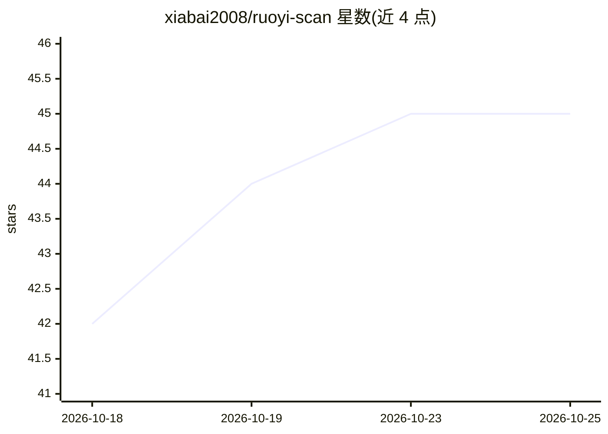

# xiabai2008/ruoyi-scan

⭐ 45 · Python · MIT · 推送 2026-10-18 · [GitHub](https://github.com/xiabai2008/ruoyi-scan) · [官网](https://xiabai2008.github.io/ruoyi-scan/) · 个人维护 · 中文 README

**面向若依框架的专项漏洞扫描器，带三态判定与 AI 辅助**

针对若依（RuoYi）及 Spring Boot、JeecgBoot 等国产 Java 框架的授权漏洞扫描器：插件化架构，54 个 POC 插件，三态判定（CONFIRMED/SAFE/UNKNOWN），支持若依 5 变体识别与版本感知过滤、WAF 绕过、漏洞利用链、nuclei 模板兼容执行、批量扫描与 7 种格式报告。AI 为可选功能：--ai 生成插件（无 Key 降级规则模板）、UNKNOWN 降噪、报告解读。提供 pip、桌面单文件 exe 与 Docker 三种分发。限合法授权场景使用。

## 筛选速览

| 维度 | 判定 | 备注 |
|---|---|---|
| AI 角色 | `ai-enhanced` | 去掉 AI 部分产品仍成立 |
| 许可风险 | `permissive` | MIT |
| 部署形态 | `desktop` | 安装包/桌面程序 |
| 模型依赖 | — | README 未给出锁定关系 |
| 硬件要求 | — | 无带数字的原话,不猜 |
| 安装摩擦 | `low` | 无编译、无系统依赖或容器化 |
| 成熟度 | — | 结构信号不足 |

## 能力要点

- 54 个 POC 插件 + 三态判定（CONFIRMED/SAFE/UNKNOWN）
- 若依 5 变体识别与 4.2/4.7/v5/3.9.x 版本感知 POC 过滤
- 兼容执行 nuclei YAML 模板（http 协议子集）
- AI POC 生成与 UNKNOWN 降噪（无 Key 时降级规则模板）

## 适用场景

- 对基于若依二次开发的政企系统做授权安全检测
- 安服交付场景直接产出多格式合规报告与整改复测
- CI/CD 中以严重度阈值退出并接入 Code Scanning

## 场景标签

`网络安全` · 领域:学习与行业

## 证据(README 行号)

> L155: |AI POC 生成|`--ai` 自然语言生成插件（LLM 自验证回灌，无 Key 降级规则模板）+ `--ai-validate` 生成即验证 / `--ai-triage` UNKNOWN 智能降噪|
> L396: |`--ai <desc>`|AI 生成插件（LLM 优先，无 Key 降级规则模板）|

## 星数曲线

2026-10-18 42 → 2026-10-25 45（+3）

---
*卡片 v1 · prompt 1.4 · 生成 2026-10-25 · 置信度 high · 依据 README sha `1711f44be4ef` · [字段定义](../../DATASET.md)*
