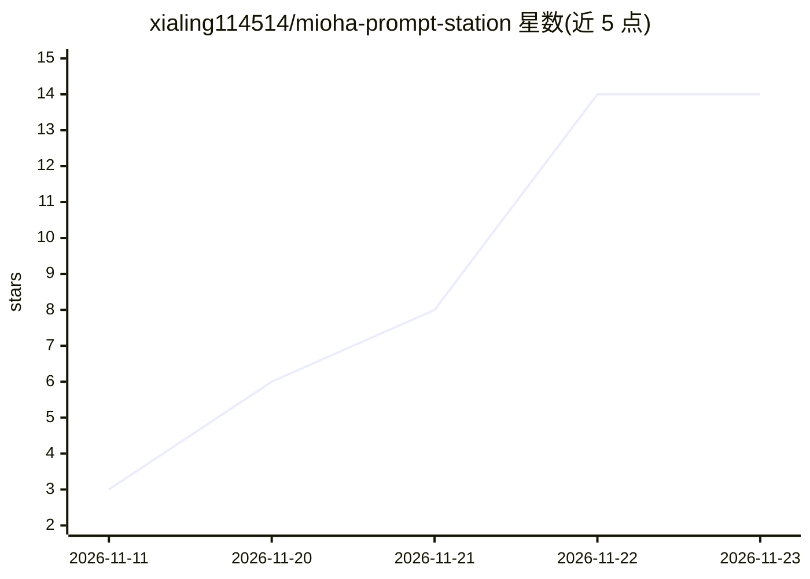

# xialing114514/mioha-prompt-station

⭐ 14 · 推送 2026-11-22 · [GitHub](https://github.com/xialing114514/mioha-prompt-station) · [官网](https://github.com/xialing114514/mioha-prompt-station/releases/latest) · 个人维护 · 中文 README

**Windows 本地绘画提示词工作台：AI 选词、模型 LoRA 管理、多引擎生图**

面向绘画创作者的本地工作台，将选词、拼画师串、试 LoRA、切换模型与生图提交整合在同一界面：支持中文描述后由 AI 按目标绘图模型规范（Anima、MOSS、NAI 等）整理提示词，内置角色配方与画师风格库，按 NeoForge/ComfyUI 分引擎管理模型与 LoRA，可直接连接引擎生成。提供 Android 独立界面经局域网/WebRTC P2P 远程连接电脑。本仓库仅提供安装包、APK 与文档，程序源码未公开；安装包不附带大语言模型与绘图权重。

## 筛选速览

| 维度 | 判定 | 备注 |
|---|---|---|
| AI 角色 | `ai-native` | 本体是模型或模型工具 |
| 许可风险 | `none` | — |
| 部署形态 | `None` |  |
| 模型依赖 | — | README 未给出锁定关系 |
| 硬件要求 | — | 无带数字的原话,不猜 |
| 安装摩擦 | `medium` | 含编译或系统依赖之一 |
| 成熟度 | — | 结构信号不足 |

## 能力要点

- 中文描述生成提示词，按 Anima/MOSS/NAI 等绘图模型规范整理
- 按 NeoForge/ComfyUI 分引擎管理模型、LoRA、预览与触发词，支持生图页内替换 LoRA
- NAI 在线法典接入原站，词条与画师串可快照保存到本地
- Android 独立界面支持局域网与 WebRTC P2P 远程连接电脑

## 适用场景

- 把画面想法整理成可直接使用的绘图提示词并反复调整
- 统一管理本地模型与 LoRA 并直接提交生图任务
- 离开电脑后用手机继续编辑并查看生图进度

## 场景标签

`提示工程` `图像生成` · 领域:Agent 开发

## 证据(README 行号)

> L19: |有画面想法，不知道怎么写词|用中文描述，AI 按目标绘图模型整理；左侧讲解设计，右侧给出提示词|
> L45: 4. **需要出图时再连接引擎。** 进入「连接生图」，配置运行中的 NeoForge／ComfyUI，或使用自己的 NovelAI 凭据；检查模型、LoRA 和参数后点击生成。

## 星数曲线

2026-11-11 3 → 2026-11-23 14（+11）

---
*卡片 v1 · prompt 1.4 · 生成 2026-11-20 · 置信度 high · 依据 README sha `6731d9ff6b37` · [字段定义](../../DATASET.md)*
